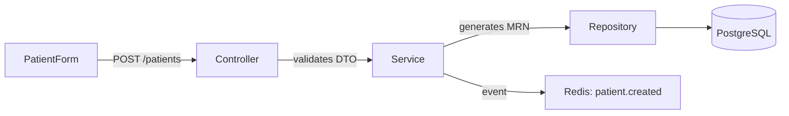
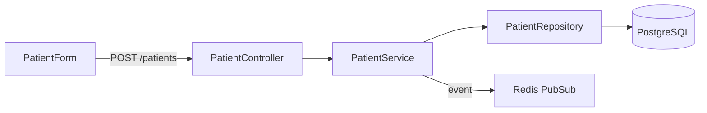

# MediCore HIS Developer Copilot

> **The definitive skill for building MediCore HIS. Every line of code follows the pre-dev documentation, SOLID principles, and clinical-grade standards. Zero mock data. Zero hardcoded values. Zero guessing.**

## When to Use This Skill

- Building any MediCore HIS feature (auth, patients, encounters, billing, pharmacy, lab, etc.)
- Implementing a page from the Pages Bible (`04-pages-bible-part*.md`)
- Creating or modifying API endpoints per OpenAPI spec
- Debugging existing MediCore code
- Reviewing code for SOLID, security, and architecture compliance
- Starting or ending a development session (changelog + overview)
- Anytime you touch MediCore source code

## When NOT to Use

- Non-MediCore projects
- Pure design/branding tasks (use `design-md` or `awesome-design-md`)
- Infrastructure-only work (use `deployment-procedures`)

---

## 🧭 MANDATORY: Source of Truth

**Before writing ANY code, read the relevant pre-dev documentation.** These files are the contract. Code that contradicts them is wrong.

| Document | Path | Purpose |
|----------|------|---------|
| Project Charter | `pre-dev/00-project-charter.md` | Vision, goals, constraints |
| PRD + SRS | `pre-dev/02-PRD.md`, `02-SRS.md` | Requirements + acceptance criteria |
| Tech Stack | `pre-dev/03-tech-stack-decisions.md` | Next.js 14, NestJS, FastAPI, PG/Mongo/Redis |
| Pages Bible | `pre-dev/04-pages-bible-part[1-5].md` | Page-level specs with wireframes |
| Screen Inventory | `pre-dev/04-screen-inventory.md`, `04-screens-phase2-3.md` | Full screen list |
| API Contracts | `pre-dev/05-api-contracts/openapi.yaml` | Backend contracts |
| OpenAPI Phase 2 | `pre-dev/05-api-contracts/openapi-phase2.yaml` | Phase 2 endpoints |
| Blueprint | `pre-dev/07-blueprint.md` | 35-step build plan |
| Design System | `/DESIGN.md` | Design tokens, components, clinical UI |
| Design Tokens CSS | `pre-dev/design-tokens.css` | Ready-to-use CSS variables |

### Reading Protocol

1. **Before implementing a page** → Read its Pages Bible entry (PG-XXX)
2. **Before creating an API endpoint** → Read the OpenAPI spec for that path
3. **Before styling** → Read `DESIGN.md` and `design-tokens.css`
4. **Before making architecture decisions** → Read `03-tech-stack-decisions.md`
5. **If unsure about scope** → Read `02-PRD.md` for the feature's requirements

---

## 🏗️ Architecture Rules (Non-Negotiable)

### Tech Stack (Locked)

```
Frontend:  Next.js 14 (App Router) + TypeScript
Backend:   NestJS + TypeScript
AI Sidecar: FastAPI + Python
Database:  PostgreSQL (structured) + MongoDB (clinical docs) + Redis (cache/pubsub)
Storage:   Cloudflare R2
Auth:      JWT (access) + httpOnly cookie (refresh)
```

### Clean Architecture Layers

```
┌─────────────────────────────────────────┐
│ Presentation (Next.js pages/components) │  ← UI only, no business logic
├─────────────────────────────────────────┤
│ Application (use cases, DTOs)           │  ← Orchestrates domain logic
├─────────────────────────────────────────┤
│ Domain (entities, value objects, events) │  ← Pure business rules
├─────────────────────────────────────────┤
│ Infrastructure (repos, DB, external)    │  ← Implementations
└─────────────────────────────────────────┘
```

### SOLID Enforcement

| Principle | Rule | Violation Example |
|-----------|------|-------------------|
| **S** Single Responsibility | Each module/file does ONE thing | ❌ `PatientService` handling billing |
| **O** Open/Closed | Extend via composition, not modification | ❌ Adding `if role === 'pharmacist'` in auth middleware |
| **L** Liskov | Subtypes must be substitutable | ❌ `EmergencyPatient` breaking `Patient` interface |
| **I** Interface Segregation | Small, focused interfaces | ❌ `IRepository` with 30 methods |
| **D** Dependency Inversion | Depend on abstractions | ❌ `PatientService` importing `PrismaClient` directly |

### File Naming Convention

```
# Backend (NestJS)
src/modules/{module}/
  ├── {module}.controller.ts     # Routes only
  ├── {module}.service.ts        # Business logic
  ├── {module}.repository.ts     # Data access
  ├── {module}.module.ts         # DI wiring
  ├── dto/
  │   ├── create-{entity}.dto.ts
  │   └── update-{entity}.dto.ts
  ├── entities/
  │   └── {entity}.entity.ts
  ├── guards/
  │   └── {module}-access.guard.ts
  └── tests/
      ├── {module}.service.spec.ts
      └── {module}.controller.spec.ts

# Frontend (Next.js App Router)
src/app/(shell)/{route}/
  ├── page.tsx                   # Page component (thin)
  ├── layout.tsx                 # Layout wrapper
  ├── loading.tsx                # Skeleton loader
  └── error.tsx                  # Error boundary

src/components/{module}/
  ├── {Component}.tsx            # UI component
  ├── {Component}.test.tsx       # Test
  └── use{Hook}.ts               # Custom hook

src/lib/
  ├── api/{module}.api.ts        # API client functions
  ├── types/{module}.types.ts    # TypeScript interfaces
  └── hooks/use{Feature}.ts      # Shared hooks
```

---

## 🚫 Absolute Rules (Break These = Reject Code)

### No Mock Data

```typescript
// ❌ NEVER
const patients = [
  { id: 1, name: "John Doe", mrn: "TEST-001" },
  { id: 2, name: "Jane Smith", mrn: "TEST-002" },
];

// ✅ ALWAYS — fetch from API
const { data: patients, isLoading, error } = useQuery({
  queryKey: ['patients', filters],
  queryFn: () => patientApi.search(filters),
});
```

### No Hardcoded Values

```typescript
// ❌ NEVER
const API_URL = "http://localhost:3001";
const TAX_RATE = 0.2;
const SESSION_TIMEOUT = 3600;

// ✅ ALWAYS — env vars or org settings
const API_URL = process.env.NEXT_PUBLIC_API_URL;
const taxRate = orgSettings.tax_rate;
const sessionTimeout = orgSettings.session_timeout_seconds;
```

### No Business Logic in Components

```tsx
// ❌ NEVER — calculation in component
function InvoicePage({ invoice }) {
  const total = invoice.items.reduce((sum, item) =>
    sum + (item.qty * item.price * (1 - item.discount / 100)), 0);
  const tax = total * 0.2;  // hardcoded!

// ✅ ALWAYS — logic in service/hook, component only renders
function InvoicePage({ invoiceId }) {
  const { invoice, totals } = useInvoice(invoiceId);
  return <InvoiceView invoice={invoice} totals={totals} />;
}
```

### Every Query Must Include Tenant Scope

```typescript
// ❌ NEVER — missing org_id/facility_id
const patients = await this.repo.find({ where: { status: 'active' } });

// ✅ ALWAYS — scoped to tenant
const patients = await this.repo.find({
  where: { org_id: ctx.orgId, facility_id: ctx.facilityId, status: 'active' },
});
```

---

## 🔄 Development Workflow (Per Feature)

> Integrates **Socratic Questioning** → **Blueprint Planning** → **TDD** → **Build** → **Adversarial Review**

### Phase 0: 🛑 Socratic Gate (MANDATORY)

**STOP. Do NOT write code yet.**

Before implementing any feature, run the Socratic Gate:

```
STEP 1: READ → Read the relevant pre-dev doc (Pages Bible, PRD, API spec)
STEP 2: SCAN → Identify which Blueprint step (of 35) this falls under
STEP 3: THINK → Identify all decision points where multiple paths exist
STEP 4: ASK → Present consequence-driven questions (minimum 3)
STEP 5: WAIT → Get user response before proceeding
```

#### Question Generation Rules

**⛔ NEVER use generic questions.** Every question must:
- Connect to an **architectural consequence** (if you pick A, then X happens)
- Eliminate at least one **implementation path**
- Include a **recommended default** so the user can reply "defaults"

#### Question Format (MANDATORY)

```markdown
🛑 **Before implementing PG-040 (Encounter Workspace), 3 decisions needed:**

---

### P0 · Layout Architecture
**Question:** 3-column (sidebar + SOAP + orders) or 2-column first?

**Why this matters:**
- 3-col requires a responsive collapse strategy now (adds ~2h)
- 2-col ships faster, 3rd column adds later without refactoring

| Option | Ships In | Risk | Best For |
|--------|----------|------|----------|
| A: 3-col now | 6h | Layout complexity on tablet | If you want full demo |
| B: 2-col → 3-col later | 3h | None — 3rd col is additive | Faster progress |

**Recommended:** B (2-column first)

---

### P1 · SOAP Autosave
**Question:** Fixed 2s interval (spec) or user-configurable?

**Why this matters:**
- Fixed = simpler code, but some doctors find it disruptive
- Configurable = org_settings table entry, adds 1 field

**Recommended:** Configurable (trivial to add, better UX)

---

### P2 · AI Copilot Panel
**Question:** Stub with "Coming in Phase 2" or omit entirely?

**Why this matters:**
- Stub keeps the layout slot reserved (no layout reflow later)
- Omit = cleaner code now, refactor layout when AI ships

**Recommended:** Stub (prevents future layout surgery)

---

**Reply: `defaults` or `1b 2a 3b`**
```

#### Decision Routing

| Situation | Action |
|-----------|--------|
| Pre-dev docs specify it explicitly | Follow docs, no question |
| Multiple valid approaches exist | Present options with recommended default |
| Impacts architecture or data model | **ALWAYS ASK** — never assume |
| Pure UI detail (spacing, animation) | Follow DESIGN.md, no question |
| Security or compliance | Flag it, offer safest default |

---

### Phase 1: 📋 Micro-Blueprint (Task Breakdown)

After the Socratic Gate is resolved, create a **micro-blueprint** for the feature.
Each task is **cold-start executable** — a fresh session can pick up any task independently.

#### Rules

- **Max 8 tasks** per feature — if more, the feature is too big, split it
- **Each task ≤ 15 minutes** of work
- **Each task independently verifiable** — has a "Done When" check
- **Dependency arrows** — which tasks block which
- **No vague verbs** — "Set up" → "Create file `X` with content `Y`"

#### Micro-Blueprint Format

```markdown
# PG-021: Patient Registration — Micro-Blueprint

## Goal
Register patients with auto-MRN, allergy tracking, insurance, and "Register & Book" shortcut.

## Dependency Graph
```
T1 (Entity) → T2 (Repo) → T3 (Service) → T4 (Controller)
                                         ↘ T5 (DTO)
T6 (API Client) → T7 (Hook) → T8 (Component + Page)
```

## Tasks

- [ ] **T1: Patient Entity** — Create `patient.entity.ts` with all columns from ERD
  → Verify: `npx tsc --noEmit` passes
  → Context: See `pre-dev/05-ERD-phase2-3.md`, Patient table

- [ ] **T2: Patient Repository** — Create `patient.repository.ts` with `findAll`, `findById`, `create`, `findByPhone`, `getNextMrnSequence`
  → Verify: Unit test `patient.repository.spec.ts` passes (3 tests)
  → Context: All methods receive `TenantContext` as first arg

- [ ] **T3: Patient Service** — Create `patient.service.ts` with MRN generation logic, duplicate phone warning
  → Verify: Unit test `patient.service.spec.ts` passes (5 tests)
  → Context: MRN format = `{ORG_PREFIX}-{YEAR}-{SEQUENCE}` (see PRD §4.2)

- [ ] **T4: Patient Controller** — Create `patient.controller.ts` with `POST /patients`, `GET /patients`, `GET /patients/:id`, `PUT /patients/:id`
  → Verify: Integration test with Supertest, all 4 routes return correct status codes
  → Context: Guards = JwtAuth + Roles(RECEPTIONIST, FACILITY_ADMIN) + TenantScoped

- [ ] **T5: Patient DTOs** — Create `create-patient.dto.ts`, `update-patient.dto.ts` with Zod schemas
  → Verify: Invalid payloads rejected with 400, valid payloads pass

- [ ] **T6: Patient API Client** — Create `lib/api/patient.api.ts`
  → Verify: TypeScript compiles, matches controller routes

- [ ] **T7: Patient Hooks** — Create `usePatients`, `usePatient`, `useCreatePatient` with React Query
  → Verify: Hook tests pass with MSW mocking

- [ ] **T8: PatientForm + Page** — Create component + route `/ops/patients/new`
  → Verify: `browser_subagent` fills form, clicks submit, sees success toast

## Done When
- [ ] All 4 endpoints return correct responses
- [ ] 15+ tests passing
- [ ] Browser shows working form with MRN preview + allergy badges
```

#### Cold-Start Context Brief (Per Task)

Each task includes a **context brief** so it can be picked up independently:

```markdown
## T3: Patient Service — Context Brief

**What:** Business logic for patient CRUD + MRN generation
**Where:** `apps/api/src/modules/patients/patient.service.ts`
**Depends On:** T1 (entity exists), T2 (repository exists)
**Pre-dev Ref:** PRD §4.2, Pages Bible PG-021, ERD Patient table
**Key Constraints:**
  - MRN = atomic PostgreSQL sequence (not JS counter)
  - Duplicate phone = warning, not blocker
  - All methods receive `TenantContext` (org_id + facility_id)
**Interfaces Consumed:** `IPatientRepository`
**Events Published:** `patient.created` (Redis PubSub)
```

---

### Phase 2: 🧪 Test First (TDD)

**Write tests BEFORE implementation.** Each task in the micro-blueprint starts with a failing test.

```
Test Cycle:
🔴 RED    → Write failing test (defines expected behavior)
🟢 GREEN  → Write MINIMAL code to pass (no premature optimization)
🔵 REFACTOR → Clean up, extract, optimize (improve without changing behavior)
```

#### Test-Behavior Mapping

For each feature, map **behaviors** to tests BEFORE writing any code:

```markdown
## Patient Registration — Test Map

| Behavior | Layer | Test |
|----------|-------|------|
| MRN format = `{PREFIX}-{YEAR}-{SEQ}` | Service | `should generate MRN with org prefix and current year` |
| Duplicate phone = warning | Service | `should warn on duplicate phone but not block creation` |
| Missing first_name = reject | DTO | `should return 400 when first_name is empty` |
| No auth token = 401 | Controller | `should return 401 without auth token` |
| Wrong role = 403 | Controller | `should return 403 for PATIENT role` |
| Cross-tenant = 404 | Controller | `should return 404 for patient in different org` |
| Form shows MRN preview | Component | `should show MRN preview after entering name` |
| Allergy badge renders | Component | `should show allergy severity badge` |
| Submit disabled until valid | Component | `should disable submit until required fields filled` |
```

---

### Phase 3: 🏗️ Build (Implementation)

Follow the **implementation staircase** — each layer depends on the one below:

```
Layer 9: PAGE              → Next.js route (assembles components)
Layer 8: COMPONENT         → React UI (uses hooks, follows DESIGN.md)
Layer 7: HOOK              → React Query (caching, invalidation, optimistic updates)
Layer 6: API CLIENT        → Typed fetch wrapper (matches controller routes)
─────────── FRONTEND / BACKEND BOUNDARY ───────────
Layer 5: DTO               → Zod schemas (validates input/output shapes)
Layer 4: CONTROLLER        → HTTP routes (uses service, applies guards)
Layer 3: SERVICE           → Business logic (uses repository, publishes events)
Layer 2: REPOSITORY        → Data access (all queries tenant-scoped)
Layer 1: ENTITY / TYPE     → Data shape (DB schema + TS interfaces)
```

#### Build Rules

| Rule | Why |
|------|-----|
| Build bottom-up (Entity → Page) | Each layer only depends on layers below it |
| One file per concern | Easy to test, review, and replace |
| Name files by domain, not by role | `patient.service.ts` not `service.ts` |
| Every function ≤ 20 lines | If longer → extract a helper |
| Every file ≤ 200 lines | If longer → split by sub-concern |
| Every component ≤ 150 JSX lines | If longer → extract sub-components |
| Zero `any` types | Use `unknown` + type guards if truly dynamic |

#### Code Quality Patterns (MANDATORY)

See `references/code-quality-patterns.md` for advanced patterns:

- **Composition over Inheritance** — Prefer HOCs / hooks / render props over class hierarchies
- **Discriminated Unions** — Model states as unions, not booleans
- **Exhaustive Switch** — Handle every case, TS compiler catches missing ones
- **Result Pattern** — Return `{ ok, data, error }` instead of throwing
- **Barrel Exports** — One `index.ts` per module, explicit re-exports
- **Compound Components** — Complex UI as composable pieces
- **State Machines** — Model multi-step flows (encounter, appointment) as XState machines
- **Optimistic Updates** — Show changes instantly, rollback on error

---

### Phase 4: ✅ Validate (Adversarial Self-Review)

After implementation, run a **5-layer validation** — be your own adversarial reviewer:

```
LAYER 1: CORRECTNESS
  → npm test -- --filter={module}        # All tests pass?
  → npx tsc --noEmit                     # Type-safe?
  → npx eslint src/modules/{module}      # Lint-clean?

LAYER 2: SECURITY
  → Every endpoint has auth + role guard?
  → Every query is tenant-scoped?
  → Input validation on ALL user inputs?
  → No data leakage in error responses?

LAYER 3: CONTRACT COMPLIANCE
  → Controller routes match OpenAPI spec?
  → DTO shapes match spec request/response?
  → Response codes match spec (201 for create, 200 for get, etc.)?

LAYER 4: UI QUALITY
  → All states handled (loading, error, empty, data)?
  → All design tokens used (no raw hex, px, font names)?
  → Keyboard navigable?
  → Works at 768px and 1440px?

LAYER 5: ADVERSARIAL EDGE CASES
  → What if the user submits the form twice rapidly?
  → What if the API returns an empty list?
  → What if the session expires mid-form?
  → What if the user has 10,000 patients? (pagination, virtual scrolling)
```

#### Adversarial Review Checklist

Before completing any task, ask yourself:

```
❓ "If I were reviewing this PR, what would I flag?"
❓ "What happens when this gets 100x more data?"
❓ "What happens when the user does something unexpected?"
❓ "Is there a simpler way to achieve the same thing?"
❓ "Will a developer in 6 months understand this code without context?"
```

### Phase 5: 📝 Changelog Entry

After completing a task, append to `CHANGELOG.md`:

```markdown
## [Unreleased]

### Added
- **PG-021 Patient Registration** — Full registration form with MRN preview,
  allergy entry, insurance section, and "Register & Book" shortcut.
  - Backend: `POST /patients`, `PUT /patients/{id}` endpoints
  - Frontend: `PatientForm` component with 7-tab keyboard flow
  - Tests: 12 unit tests, 3 integration tests
  - Security: Input validation (Zod), phone duplicate warning (not blocker)
```

### Phase 6: 📸 Showcase Build

**After every implemented feature**, generate a standalone showcase version in `showcase/`.
This serves two purposes:
1. **Social media content** — Short demo of the feature for LinkedIn/X/Instagram
2. **Personal learning** — Isolated, annotated code to understand the concept

#### What Gets Generated

For each completed feature, create a self-contained HTML page in `showcase/`:

```
showcase/
├── README.md                          # Index of all showcase demos
├── 001-login-auth/
│   ├── index.html                     # Standalone demo (works without backend)
│   ├── LEARN.md                       # Educational breakdown
│   └── social-caption.md              # Ready-to-post caption + hashtags
├── 002-patient-registration/
│   ├── index.html
│   ├── LEARN.md
│   └── social-caption.md
├── 003-appointment-calendar/
│   ├── index.html
│   ├── LEARN.md
│   └── social-caption.md
└── ...
```

#### Showcase Generation Rules

1. **Self-contained** — Single `index.html` with inline CSS/JS. Opens in any browser. No server needed.
2. **Uses real design tokens** — Import `design-tokens.css` so it looks exactly like the real app.
3. **Simulated data** — Uses realistic (not Lorem Ipsum) Moroccan names, MAD currency, real ICD-10 codes.
4. **Interactive** — Forms work, buttons animate, states transition. Not a dead screenshot.
5. **Annotated** — Code comments explain WHAT and WHY for each section.
6. **Responsive** — Works on mobile for Instagram stories / LinkedIn mobile.

#### index.html Pattern

```html
<!-- showcase/002-patient-registration/index.html -->
<!DOCTYPE html>
<html lang="en" data-theme="dark">
<head>
  <meta charset="UTF-8">
  <meta name="viewport" content="width=device-width, initial-scale=1.0">
  <title>MediCore — Patient Registration (Showcase)</title>
  <link rel="stylesheet" href="../../pre-dev/design-tokens.css">
  <style>
    /* Showcase-specific styles using design tokens */
    /* ... minimal styles, reusing vars from design-tokens.css ... */
  </style>
</head>
<body>
  <header class="showcase-header">
    <span class="badge">🏥 MediCore HIS — Feature Showcase</span>
    <h1>Patient Registration</h1>
    <p class="subtitle">Real-time MRN generation, allergy tracking, and insurance entry</p>
  </header>

  <main>
    <!-- Simplified, working version of the feature -->
    <!-- Each section annotated with <!-- LEARN: ... --> comments -->
  </main>

  <footer class="showcase-footer">
    <p>Built by <strong>Oussama Zaki</strong> · MediCore HIS · Day {{N}}</p>
    <p class="tech">Next.js 14 · NestJS · PostgreSQL · TypeScript</p>
  </footer>

  <script>
    // Simulated interactions — NO backend calls
    // Uses realistic data patterns
  </script>
</body>
</html>
```

#### LEARN.md Pattern

```markdown
# Patient Registration — How It Works

## 🧠 Concepts Used
1. **MRN Generation** — {ORG_PREFIX}-{YEAR}-{SEQUENCE}
   - Sequence is atomic (DB sequence, not JS counter)
   - Why: Prevents duplicate MRNs even with concurrent registrations

2. **Zod Validation** — Schema-first input validation
   ```typescript
   // Instead of manual if/else chains:
   const schema = z.object({
     first_name: z.string().min(1).max(100),
     phone: z.string().regex(/^\+212[0-9]{9}$/),
   });
   // One line validates everything and gives typed output
   ```

3. **Duplicate Phone Warning** — Soft constraint
   - WHY not block: Families share phones in Morocco
   - HOW: Service returns `{ patient, warnings: ['DUPLICATE_PHONE'] }`
   - UI shows ⚠️ toast but allows submission

## 🏗️ Architecture Flow


## 📂 Files in Real App
| File | Purpose |
|------|---------|
| `patient.entity.ts` | DB schema |
| `patient.service.ts` | MRN generation + business rules |
| `patient.controller.ts` | HTTP routes + validation |
| `PatientForm.tsx` | React form component |
| `useCreatePatient.ts` | React Query mutation hook |
```

#### social-caption.md Pattern

```markdown
# Social Media Caption

## LinkedIn / X Post

Day {{N}} of building MediCore HIS 🏥

✅ Patient Registration is LIVE

What it does:
→ Auto-generates unique Medical Record Numbers (MRN)
→ Real-time allergy tracking with severity badges
→ Insurance entry with provider lookup
→ Bi-directional duplicate phone detection (warning, not blocker)

Tech: Next.js 14 + NestJS + PostgreSQL + TypeScript

Architecture decisions:
• Clean Architecture (Controller → Service → Repository)
• Zod for schema-first validation
• Redis events for downstream modules

#buildinpublic #healthtech #nextjs #typescript #saas #medtech

## Instagram Story
🏥 MediCore HIS — Day {{N}}
✅ Patient Registration
🔐 Real MRN generation
⚡ Sub-200ms registration
💡 Allergy severity badges
Swipe → for code breakdown

## Short Thread (X)
1/ Building a Hospital Information System from scratch 🏥

Day {{N}}: Patient Registration

The MRN (Medical Record Number) generation was the tricky part.
It needs to be:
- Unique across the org
- Sequential
- Never have gaps

Here's how I solved it 🧵

2/ I used PostgreSQL sequences instead of auto-increment.
Why? Sequences are atomic — even if two receptionists
register patients at the exact same millisecond,
they'll get different MRNs. No race conditions.

3/ The format: {ORG_PREFIX}-{YEAR}-{SEQUENCE}
Example: CEA-2026-00048

The prefix is set during onboarding.
The year resets the display (not the sequence).
The sequence never resets — always increases.

4/ Next up: Patient Profile & Timeline
Where all encounters, labs, and invoices merge
into a single chronological feed.

Follow along → @zakio_dev
```

#### When to Generate Showcase

Generate a showcase build when:
- ✅ A full page (PG-XXX) is implemented and tested
- ✅ A significant UI component is completed (encounter workspace, calendar, etc.)
- ✅ User explicitly asks: "make a showcase", "create demo", "social media version"

Do NOT generate for:
- ❌ Backend-only work (no visual to show)
- ❌ Bug fixes or refactors
- ❌ Configuration changes

#### Showcase Index (README.md)

Maintain `showcase/README.md` as a gallery:

```markdown
# MediCore HIS — Showcase Gallery

> Progress demos for each implemented feature. Open any `index.html` in a browser.

| # | Feature | Day | Status | Demo |
|---|---------|-----|--------|------|
| 001 | Login & Auth | Day 3 | ✅ | [Open](./001-login-auth/index.html) |
| 002 | Patient Registration | Day 5 | ✅ | [Open](./002-patient-registration/index.html) |
| 003 | Appointment Calendar | Day 8 | ✅ | [Open](./003-appointment-calendar/index.html) |
| 004 | Encounter Workspace | Day 12 | 🔜 | — |
```

### Phase 7: 📊 Session Overview (End of Day/Session)

When the user says "session overview", "what did we do", or "end of day":

```markdown
# Session Overview — [Date]

## ✅ Completed Tasks
1. **PG-021 Patient Registration** (Step 8 of Blueprint)
   - Created `patient.entity.ts`, `patient.service.ts`, `patient.controller.ts`
   - Frontend: `PatientForm.tsx` with allergy badges, insurance section
   - 15 tests passing (12 unit, 3 integration)

2. **PG-020 Patient List** (Step 8 of Blueprint)
   - Search with debounce, filter chips, CSV export
   - 8 tests passing

## 📊 Architecture Diagram (Updated)


## 🧪 Test Results
- Total: 23 tests, 23 passing, 0 failing
- Coverage: PatientService 94%, PatientController 87%

## 🔒 Security Notes
- Input validation: Zod schemas on all DTOs
- Tenant scoping: All queries include org_id + facility_id
- No secrets hardcoded

## ⏭️ Next Steps
- PG-022 Patient Profile & Timeline
- PG-030 Doctor Schedule Management

## 📝 Decisions Made
| Decision | Rationale |
|----------|-----------|
| Used Zod over class-validator | Better TypeScript inference, tree-shakeable |
| Duplicate phone = warning | Users said same family uses same phone |
```

---

## 📚 Learning Mode

When implementing a concept the user marks as new or unfamiliar, provide a **simplified version** alongside the real implementation:

```
💡 NEW CONCEPT: Repository Pattern

// SIMPLIFIED — what it means in plain terms:
// Instead of calling the database directly from your service,
// you create a "middleman" (repository) that handles all DB queries.
// This means you can swap PostgreSQL for MongoDB without changing
// your business logic.

// THE PATTERN:
interface IPatientRepository {
  findById(id: string): Promise<Patient | null>;
  create(data: CreatePatientDto): Promise<Patient>;
}

// WHY: Your PatientService doesn't know or care if we use
// PostgreSQL, MongoDB, or a text file. It just calls
// repository.findById('123') and gets a Patient back.

// REAL IMPLEMENTATION (what we actually write):
@Injectable()
class PatientRepository implements IPatientRepository {
  constructor(
    @InjectRepository(PatientEntity)
    private readonly repo: Repository<PatientEntity>,
  ) {}

  async findById(id: string): Promise<Patient | null> {
    return this.repo.findOne({ where: { id } });
  }
}
```

---

## 🔒 Security Checklist (Per Endpoint)

Every API endpoint MUST pass:

- [ ] **Input validation** — Zod/class-validator on all DTOs
- [ ] **Authentication** — JWT guard on all non-public routes
- [ ] **Authorization** — Role guard (`@Roles('DOCTOR', 'NURSE')`)
- [ ] **Tenant scoping** — `org_id` + `facility_id` in every query
- [ ] **Rate limiting** — Applied (strict on auth, standard on CRUD)
- [ ] **No data leakage** — Error messages are generic, no stack traces
- [ ] **Audit log** — State-changing ops logged with user, action, timestamp
- [ ] **SQL injection** — Parameterized queries only (ORM handles this)
- [ ] **XSS** — User content sanitized before storage
- [ ] **CORS** — Configured to allow only known origins

---

## 🎨 UI Implementation Rules

### Follow DESIGN.md

```css
/* ✅ Use design tokens — NEVER raw values */
background: var(--bg-surface);     /* not #111111 */
color: var(--text-primary);        /* not white */
border: 1px solid var(--border-default); /* not #333 */
font-family: var(--font-sans);     /* not 'Inter' */
border-radius: var(--radius-md);   /* not 8px */
```

### Component States (Every Component)

Every data-fetching component handles ALL states:

```tsx
function PatientList() {
  const { data, isLoading, error, isEmpty } = usePatients(filters);

  if (isLoading) return <PatientListSkeleton />;    // Skeleton, not spinner
  if (error) return <ErrorState onRetry={refetch} />;
  if (isEmpty) return <EmptyState
    icon={<UsersIcon />}
    title="No patients yet"
    action={{ label: "Register first patient", href: "/ops/patients/new" }}
  />;

  return <PatientTable data={data} />;
}
```

### Responsive Rules

```
Desktop (≥1280px):  Full layout (sidebars, multi-column)
Tablet (768–1279px): Collapsible sidebar, stacked columns
Mobile (<768px):     Bottom nav, single column, touch-optimized
```

---

## 🧪 Testing Standards

| Layer | Tool | Coverage Target |
|-------|------|-----------------|
| Unit (services) | Jest/Vitest | 90%+ |
| Integration (API) | Supertest | All endpoints |
| Component | Testing Library | All interactive components |
| E2E (journeys) | Playwright | Core flows (login → encounter → sign-off) |

### Test Naming

```typescript
describe('PatientService', () => {
  describe('create', () => {
    it('should generate MRN with org prefix and current year', () => {});
    it('should reject when first_name is missing', () => {});
    it('should warn on duplicate phone but not block creation', () => {});
  });
});
// Pattern: should {expected behavior} when {condition}
```

---

## 🔍 Research & Suggestions Protocol

When implementing a feature:

1. **Search** for battle-tested libraries before writing custom code
2. **Suggest** improvements over the pre-dev spec if you find better patterns
3. **Flag** potential issues: "⚠️ The spec says X but Y would be better because Z. Proceed with spec or switch?"
4. **Reference** real-world HMS implementations when relevant

---

## 📋 Anti-Patterns (Instant Rejection)

| Pattern | Why It's Wrong |
|---------|---------------|
| `any` type in TypeScript | Defeats type safety |
| `// TODO: implement later` | Ship complete or don't ship |
| Console.log in production code | Use structured logger |
| Fetching inside `useEffect` directly | Use React Query |
| Raw SQL concatenation | SQL injection risk |
| `localStorage` for auth tokens | XSS risk — use httpOnly cookies |
| Components >200 lines | Split into smaller components |
| Services >300 lines | Split into focused services |
| Files named `utils.ts` or `helpers.ts` | Use domain-specific names |
| Skipping loading/error states | UI must handle ALL states |

---

## References

For extended patterns, see:
- `references/code-quality-patterns.md` — Discriminated unions, state machines, compound components, Result pattern, optimistic updates, performance patterns
- `references/implementation-playbook.md` — Detailed patterns for each module
- `references/api-gap-tracker.md` — All 25 missing endpoints with implementation guidance
- `references/testing-patterns.md` — TDD examples for each layer
- `references/showcase-protocol.md` — Showcase build examples and social media templates
- `references/session-review-template.md` — End-of-session report template

