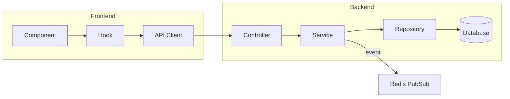

# MediCore HIS — Session Review Template

> Used at the end of every development session. Copy this template and fill in.

---

## Session Overview — {{DATE}}

### ⏰ Session Duration
- Start: {{TIME}}
- End: {{TIME}}
- Blueprint Steps Worked On: Step {{N}} of 35

---

### ✅ Completed Tasks

| # | Task | Blueprint Step | Pages Bible | Status |
|---|------|---------------|-------------|--------|
| 1 | {{Task name}} | Step {{N}} | PG-{{XXX}} | ✅ Done |
| 2 | {{Task name}} | Step {{N}} | PG-{{XXX}} | ⏳ In Progress |

#### Task Details

**1. {{Task Name}}**
- Files created/modified:
  - `src/modules/{{module}}/{{file}}.ts` — {{what it does}}
  - `src/components/{{module}}/{{Component}}.tsx` — {{what it does}}
- API endpoints implemented:
  - `{{METHOD}} /{{path}}` — {{description}}
- Key decisions:
  - {{Decision}} — Rationale: {{why}}

---

### 📊 Architecture Diagram (Updated)



---

### 🧪 Test Results

```
Test Suites: {{N}} passed, {{N}} total
Tests:       {{N}} passed, {{N}} total
Coverage:
  - {{Module}}Service: {{N}}%
  - {{Module}}Controller: {{N}}%
  - {{Component}}: {{N}}%
```

---

### 🔒 Security Review

| Check | Status | Notes |
|-------|--------|-------|
| Input validation (DTOs) | ✅/❌ | {{notes}} |
| Auth guards on endpoints | ✅/❌ | {{notes}} |
| Tenant scoping in queries | ✅/❌ | {{notes}} |
| No hardcoded values | ✅/❌ | {{notes}} |
| Audit logging | ✅/❌ | {{notes}} |
| Error messages sanitized | ✅/❌ | {{notes}} |

---

### 💡 New Concepts Introduced

| Concept | Explanation | Example File |
|---------|-------------|-------------|
| {{Concept}} | {{1-2 sentence explanation}} | `{{file}}` |

---

### 📝 Decisions Made

| # | Decision | Options Considered | Chosen | Rationale |
|---|----------|-------------------|--------|-----------|
| 1 | {{decision}} | A: {{opt}}, B: {{opt}} | {{A/B}} | {{why}} |

---

### ⚠️ Known Issues / Technical Debt

| # | Issue | Severity | Ticket |
|---|-------|----------|--------|
| 1 | {{issue}} | Low/Med/High | {{link}} |

---

### ⏭️ Next Session Plan

| Priority | Task | Blueprint Step | Estimated Time |
|----------|------|---------------|----------------|
| 1 | {{Next task}} | Step {{N}} | {{Xh}} |
| 2 | {{Next task}} | Step {{N}} | {{Xh}} |

---

### 📋 Changelog Entries Added

```markdown
## [Unreleased]

### Added
- {{entry}}
- {{entry}}

### Changed
- {{entry}}

### Fixed
- {{entry}}
```

---

### 📈 Progress Snapshot

```
Blueprint Progress: Step {{N}} / 35 ({{N}}%)
Total API Endpoints: {{N}} / {{Total}} implemented
Total Pages: {{N}} / 67 implemented
Total Tests: {{N}} passing
```
