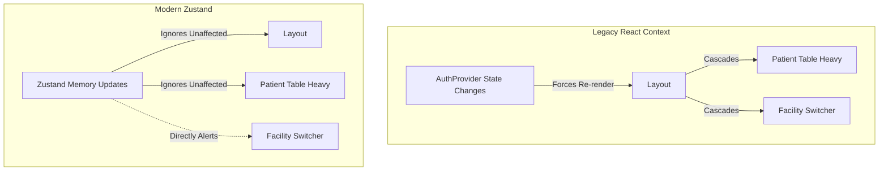

# Architectural Shift: React Context to Zustand

## 🧠 Concepts Used
1. **The React Context Problem**
   React's native `createContext()` is fantastic for dependency injection (like passing a theme). However, it is **terrible** for high-frequency state management. Whenever the values inside `AuthContext.Provider` change (like switching active clinics or modifying user roles), React triggers a recursive DOM check, structurally forcing *every single child component* inside that Provider to recalculate, even if they never invoked `useAuth()`. For a hospital system drawing tables of thousands of patients, this causes devastating performance stutter.

2. **The Zustand Solution (`useAuthStore`)**
   Zustand extracts the state explicitly OUT of the React DOM tree entirely. It exists purely in Javascript runtime memory. When `switchFacility()` is called, the DOM tree is not alerted. Instead, Zustand directly invokes specific React `useState` hooks natively ONLY inside the isolated components actively listening for `state.activeFacility`.
   - **Why:** Massive performance gains, decoupling memory state from UI components, and simpler testing.

3. **The "Facade" Refactoring Strategy**
   Ripping out `AuthContext` natively would require editing thousands of import lines across `apps/web`. To prevent a huge Git diff conflict:
   - We kept the file `auth-context.tsx`.
   - We gutted the Provider logic so it just renders `<>{children}</>`.
   - We mapped the legacy hook `export function useAuth() { return useAuthStore() }`.
   - **Why:** Instant backwards compatibility. The rest of the app became mathematically faster instantaneously without changing a single line in those UI files.

## 🏗️ Architecture Flow

## 📂 Files Impacted
| File | Purpose |
|------|---------|
| `apps/web/src/lib/store/auth-store.ts` | The new global singleton memory store. |
| `apps/web/src/lib/auth/auth-context.tsx` | The legacy context shell converted into a Facade interface. |
| `apps/web/src/app/layout.tsx` | The root DOM level wrapper (now free of state constraints). |
