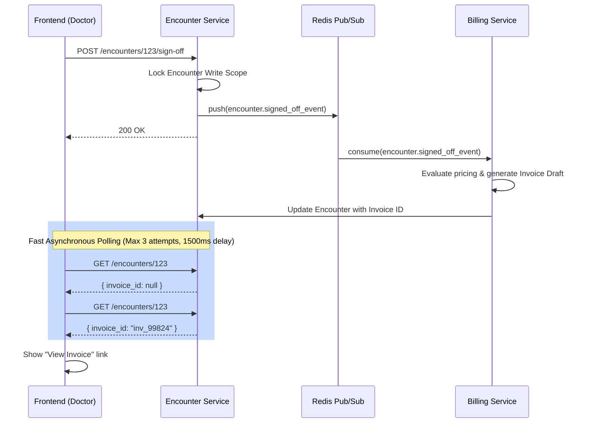

# Redis PubSub & Encounter Sign-Off

## 🧠 Concepts Used
1. **The Lock Enforcement Protocol (`PG-043`)**
   In a massive multi-tenant healthcare system, clinical records must be legally immutable once signed. When the Doctor clicks "Sign Off", the backend updates `status="signed_off"`. From that atomic split-second onward, all `PUT` operations to the REST API on that encounter ID forcefully reject with an HTTP `403 Forbidden`. The frontend Zustand store then instantly toggles the local `isReadOnly` state.

2. **The Asynchronous Pipeline (Pub/Sub)**
   The Encounter service doesn't block the UI while talking to the Billing microservice. Instead of HTTP calling (which can timeout if billing is overloaded), the Encounter service pushes a message to a **Redis Event Queue** (e.g. `encounter.signed_off`). 
   - **Why:** Massive scalability. The billing service gracefully digests these events matching schemas like `{ "patientId": "...", "items": [] }`.

3. **Short Polling Confirmation**
   To reassure the Doctor, the UI doesn't simply say "Done." The frontend initiates a short, graceful 3-try loop checking `EncounterApi.getById(...)`. Once the Redis queue evaluates the invoice, the Billing service stamps `invoice_id` back onto the Encounter document. The UI displays "View Draft Invoice ->" precisely when the stamp is recognized.

## 🏗️ Architecture Flow

