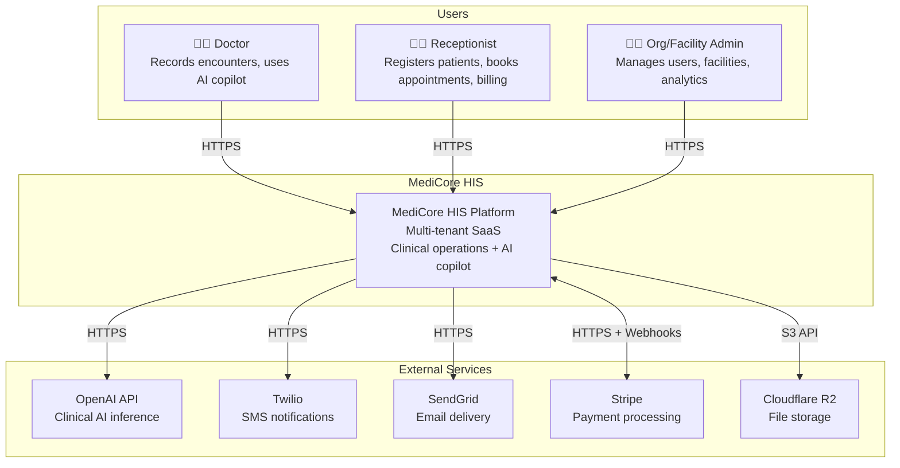
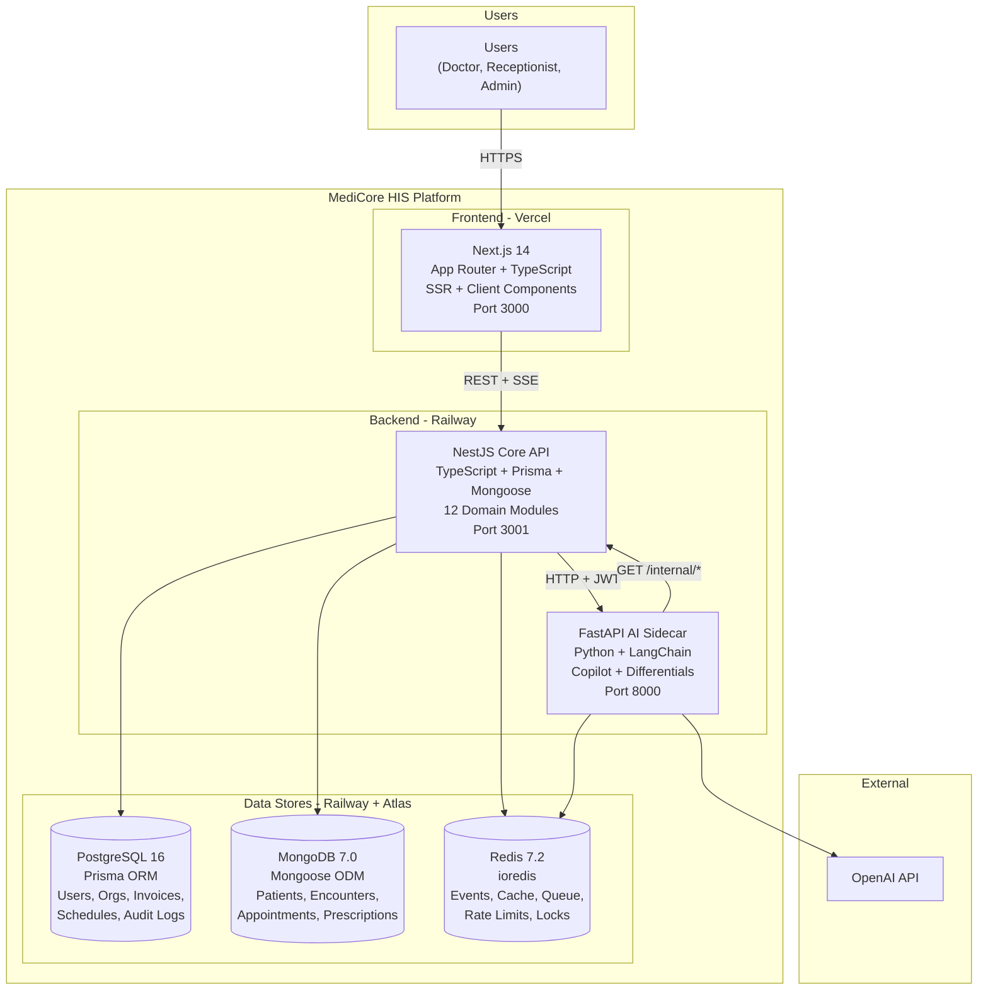
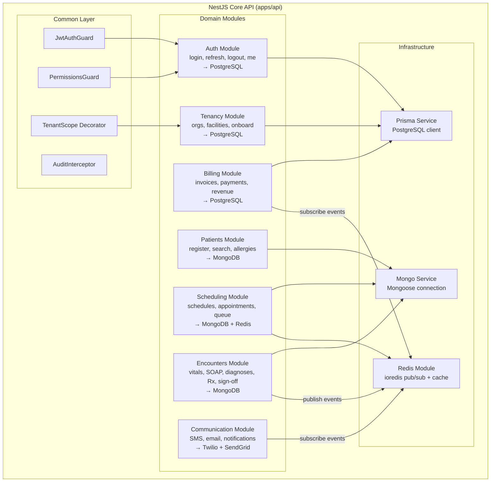
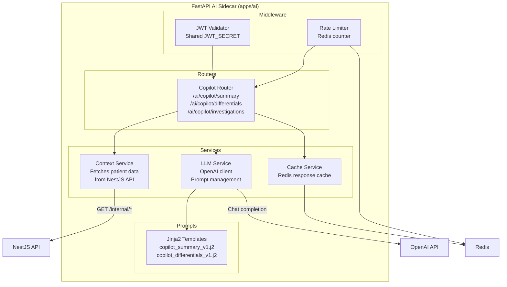
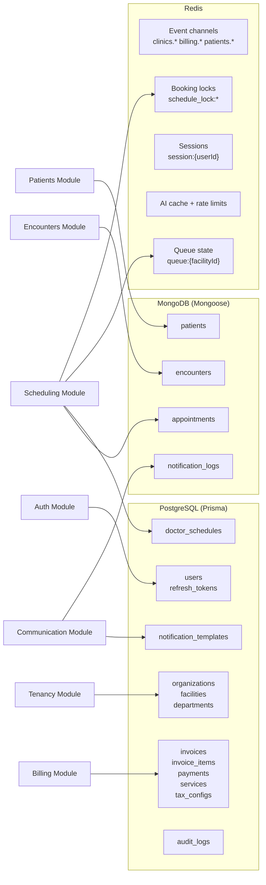

# Phase 3 — C4 Diagrams

## MediCore HIS — Architecture Diagrams (C4 Model)

---

## 1. C4 Context Diagram (Level 1)

Shows MediCore as a single system interacting with users and external services.

---

## 2. C4 Container Diagram (Level 2)

Shows the internal runtime containers and data stores.

---

## 3. C4 Component Diagram (Level 3) — NestJS Core API

Shows the internal modules of the main backend service.

---

## 4. C4 Component Diagram (Level 3) — FastAPI AI Sidecar

---

## 5. Data Ownership Map

Each NestJS module owns specific data stores. No module crosses data boundaries.

> **Exception**: The Scheduling module touches both PostgreSQL (doctor_schedules) and MongoDB (appointments). This is intentional — schedules are structured/relational (JOINed with Users), while appointments are document-like (embedded status_history). The module internally uses two repository classes: `sched-pg.repository.ts` and `sched-mongo.repository.ts`.
