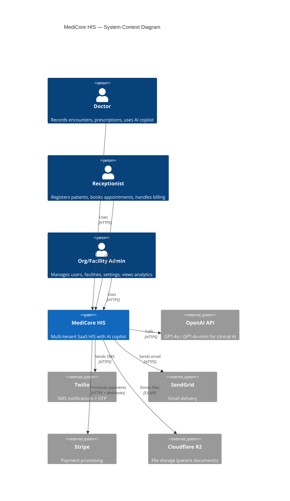
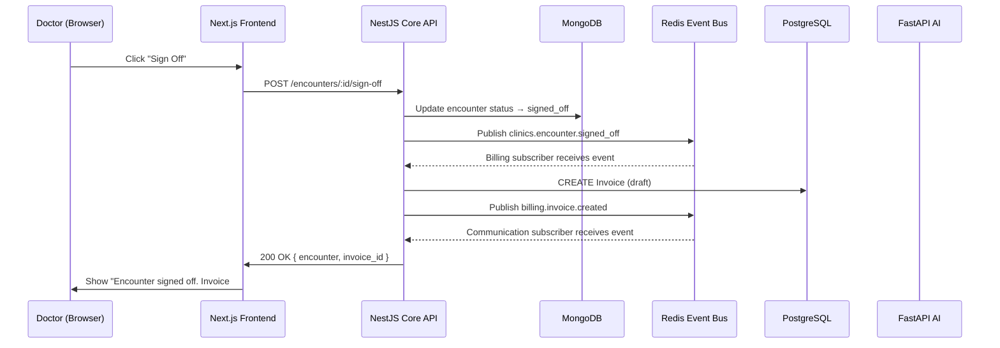
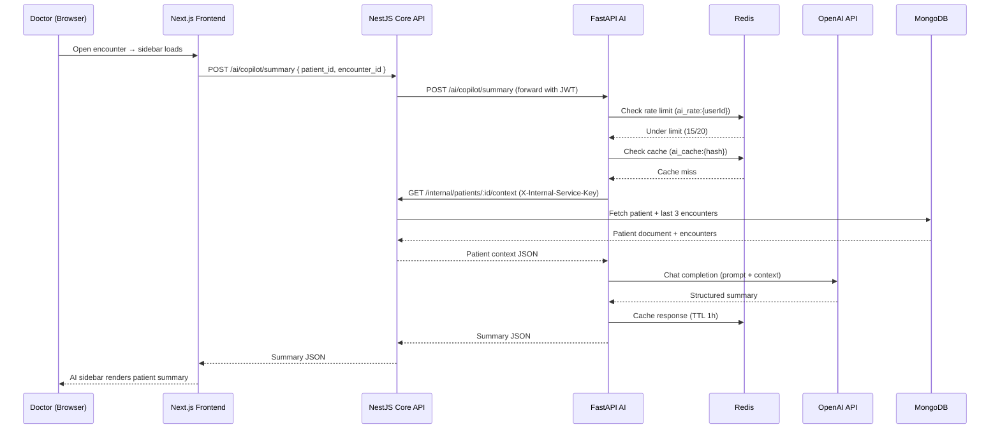
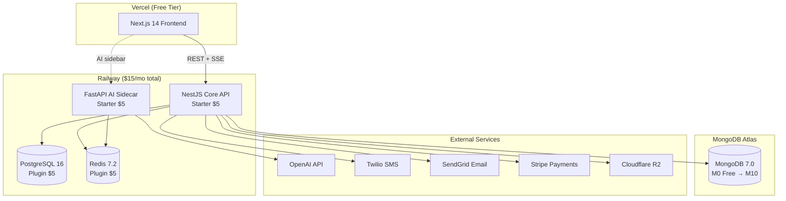

# Phase 3 — Architecture Overview

## MediCore HIS — System Architecture

---

## 1. System Context

MediCore HIS is a multi-service SaaS platform with three runtime components, three data stores, and five external integrations:



---

## 2. Major Components and Responsibilities

| Component | Technology | Responsibility | Port |
|-----------|-----------|---------------|------|
| **Web Frontend** | Next.js 14 (App Router, TypeScript) | UI rendering, route protection, API calls, SSE consumption | 3000 |
| **Core API** | NestJS (TypeScript, Prisma, Mongoose) | All business logic: auth, tenancy, patients, scheduling, encounters, billing, communication | 3001 |
| **AI Sidecar** | FastAPI (Python, Pydantic, LangChain) | AI inference: copilot summaries, differentials, investigations | 8000 |
| **PostgreSQL** | PostgreSQL 16 | Relational data: users, orgs, facilities, invoices, payments, schedules, audit logs | 5432 |
| **MongoDB** | MongoDB 7.0 | Document data: patients, encounters, appointments, prescriptions, notification logs | 27017 |
| **Redis** | Redis 7.2 | Event bus (pub/sub), session cache, queue state, AI rate limiting, booking locks | 6379 |

---

## 3. Data Flow Summary

### Write Path: Doctor Signs Off an Encounter



### Read Path: AI Copilot Generates Patient Summary



---

## 4. Third-Party Integration Map

| Service | Used By | Purpose | Auth Method | Cost Model |
|---------|---------|---------|-------------|------------|
| OpenAI API | FastAPI | GPT-4o/mini for clinical AI | API key | Pay-per-token ($0.005/1K tokens) |
| Twilio | NestJS | SMS (confirmations, reminders) | API key + SID | Pay-per-SMS ($0.02/SMS) |
| SendGrid | NestJS | Email (invoices, notifications) | API key | Free tier: 100/day |
| Stripe | NestJS + Next.js | Payment processing | API key + webhook secret | 2.9% + $0.30 per transaction |
| Cloudflare R2 | NestJS | Document upload/storage | S3-compatible keys | Free 10GB, then $0.015/GB |
| MongoDB Atlas | NestJS | Clinical document database | Connection URI + credentials | Free M0 → $57/mo M10 |
| Railway | All services | PaaS hosting + PG + Redis | Dashboard config | $5/service/mo |
| Vercel | Next.js | Frontend hosting + SSR | Git integration | Free hobby tier |

---

## 5. Communication Patterns

### Module-to-Module Communication

Modules inside NestJS communicate **exclusively via Redis events**. No module imports another module's service directly.

| Event | Publisher | Subscriber(s) | Action |
|-------|----------|---------------|--------|
| `tenancy.facility.created` | Tenancy | (future: analytics) | Log new facility |
| `patients.patient.registered` | Patients | (future: communication) | Welcome SMS |
| `clinics.appointment.confirmed` | Scheduling | Communication | Send confirmation SMS |
| `clinics.appointment.checked_in` | Scheduling | (SSE broadcaster) | Push to queue display |
| `clinics.encounter.signed_off` | Encounters | Billing, Communication | Create invoice, send notification |
| `clinics.prescription.issued` | Encounters | (Phase 2: Pharmacy) | Notify pharmacy |
| `clinics.lab-order.created` | Encounters | (Phase 2: Labs) | Notify lab |
| `billing.invoice.created` | Billing | Communication | Send invoice email |
| `billing.invoice.paid` | Billing | Communication | Send payment confirmation |

### Event Envelope Format

```json
{
  "event": "clinics.encounter.signed_off",
  "org_id": "clx123abc",
  "facility_id": "clx456def",
  "actor_id": "clx789ghi",
  "timestamp": "2026-04-07T14:30:00.000Z",
  "payload": {
    "encounter_id": "6612abc...",
    "patient_id": "6612def...",
    "doctor_id": "clx789ghi"
  }
}
```

---

## 6. Deployment Overview



**Total cost**: ~$20/mo (dev) → ~$80–120/mo (first clinic live)
