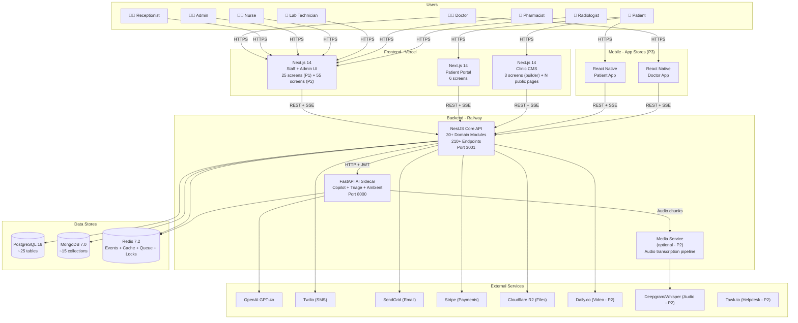
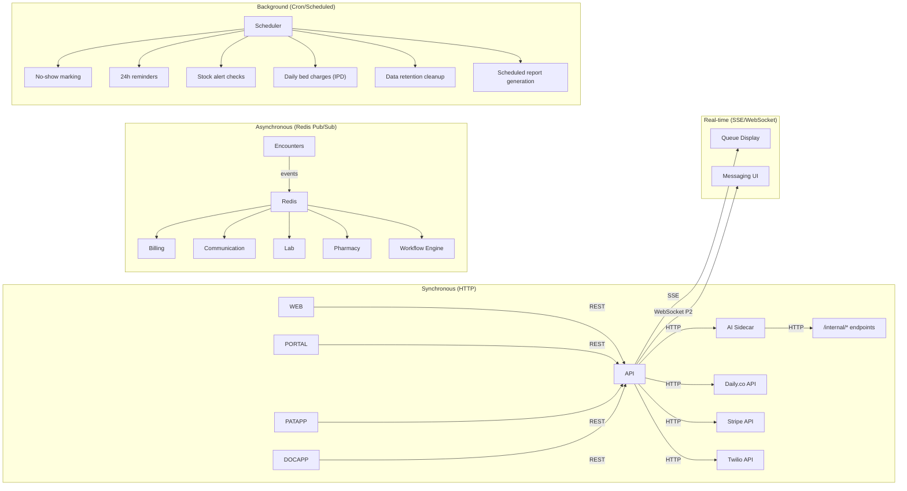
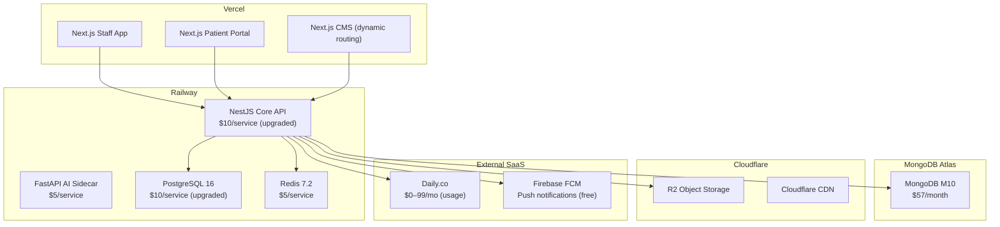

# Phase 2 & 3 — Architecture Expansion

## MediCore HIS — Extended System Architecture (All Phases)

> Extends `03-architecture-overview.md`. MVP architecture remains unchanged. This document adds Phase 2/3 modules, data stores, events, and service topology.

---

## 1. Full System Container Diagram (All Phases)

---

## 2. NestJS Module Map (All Phases)

```mermaid
graph TB
    subgraph "Phase 1 - MVP Modules"
        AUTH["Auth Module"]
        TNCY["Tenancy Module"]
        PAT["Patients Module"]
        SCHED["Scheduling Module"]
        ENC["Encounters Module"]
        BILL["Billing Module"]
        COMM["Communication Module"]
    end

    subgraph "Phase 2 Modules"
        PORTAL["Portal Module<br/>OTP auth, patient self-service"]
        LAB["Lab Module<br/>Orders, specimens, results"]
        PHARMA["Pharmacy Module<br/>Drug catalog, inventory, dispensing"]
        TELE["Telemedicine Module<br/>Video rooms, sessions"]
        IPD["IPD Module<br/>Wards, beds, admissions, discharge"]
        INV["Inventory Module<br/>Stock, purchase orders"]
        RAD["Radiology Module<br/>Orders, reports, PACS"]
        MSG["Messaging Module<br/>DMs, groups, notifications"]
        TRIAGE["Triage Module<br/>Chatbot, symptom intake"]
        AMBIENT["Ambient AI Module<br/>Audio capture, transcription"]
        WIDGET["Booking Widget Module<br/>Public API, guest booking"]
        CAMPAIGN["Campaigns Module<br/>SMS/email bulk outreach"]
        ANALYTICS["Analytics Module<br/>KPIs, demographics, reports"]
        I18N["i18n Module<br/>Translation management"]
        CMSMOD["CMS Module<br/>Pages, sections, domains"]
        CONFIG["Config Module<br/>Module toggles, custom fields"]
        BACKUP["Backup Module<br/>Admin backup/restore"]
    end

    subgraph "Phase 3 Modules"
        HR["HR Module<br/>Staff, attendance, payroll"]
        WF["Workflow Module<br/>Rules engine, visual builder"]
        FHIR["FHIR Module<br/>R4 resource endpoints"]
        AIADV["AI Advanced Module<br/>Optimization, risk scoring"]
        AMBU["Ambulance Module<br/>Fleet, dispatch, billing"]
    end

    subgraph "Events (Redis Pub/Sub)"
        EVT["Event Channels"]
    end

    ENC -->|encounter.signed_off| EVT
    EVT -->|subscribe| BILL
    EVT -->|subscribe| COMM
    EVT -->|subscribe| LAB
    EVT -->|subscribe| PHARMA
    EVT -->|subscribe| WF
    LAB -->|lab.result.authorized| EVT
    PHARMA -->|pharmacy.dispensed| EVT
    IPD -->|ipd.discharged| EVT
    SCHED -->|appointment.checked_in| EVT
    PORTAL -->|portal.appointment.booked| EVT
```

---

## 3. Event Bus Contracts (Phase 2/3 Additions)

### New Event Channels

| Channel | Event | Payload | Published By | Consumed By |
|---------|-------|---------|-------------|-------------|
| `lab.*` | `lab.order.created` | `{ order_id, patient_id, encounter_id, tests[], ordered_by }` | Encounters | Lab Module |
| `lab.*` | `lab.specimen.collected` | `{ order_id, specimen_id, collected_at }` | Lab | — |
| `lab.*` | `lab.result.entered` | `{ order_id, results[], abnormal_flags[] }` | Lab | Communication (alert doctor) |
| `lab.*` | `lab.result.authorized` | `{ order_id, authorized_by, authorized_at }` | Lab | Billing (auto-add charges), Encounters (attach results) |
| `pharmacy.*` | `pharmacy.rx.received` | `{ prescription_id, patient_id, drugs[] }` | Encounters | Pharmacy Module |
| `pharmacy.*` | `pharmacy.dispensed` | `{ prescription_id, dispensed_items[], dispensed_by }` | Pharmacy | Billing (add charges), Encounters (mark dispensed) |
| `pharmacy.*` | `pharmacy.stock.low` | `{ drug_id, drug_name, current_qty, reorder_level }` | Pharmacy | Communication (alert admin) |
| `radiology.*` | `radiology.order.created` | `{ order_id, patient_id, test_type, ordered_by }` | Encounters | Radiology Module |
| `radiology.*` | `radiology.report.authorized` | `{ order_id, report_id, authorized_by }` | Radiology | Billing, Encounters |
| `ipd.*` | `ipd.patient.admitted` | `{ admission_id, patient_id, bed_id, ward_id, admitted_by }` | IPD | Communication (notify), Billing (start bed charges) |
| `ipd.*` | `ipd.bed.transferred` | `{ admission_id, from_bed, to_bed, transferred_at }` | IPD | Billing (adjust charges) |
| `ipd.*` | `ipd.patient.discharged` | `{ admission_id, patient_id, discharge_summary_id, discharged_at }` | IPD | Billing (finalize), Communication (discharge instructions) |
| `portal.*` | `portal.appointment.booked` | `{ appointment_id, patient_id, booked_via: "portal" }` | Portal | Scheduling (same handler), Communication |
| `portal.*` | `portal.payment.completed` | `{ invoice_id, payment_id, method: "stripe", amount }` | Portal | Billing (update status) |
| `telemedicine.*` | `telemedicine.session.started` | `{ session_id, appointment_id, room_url }` | Telemedicine | — |
| `telemedicine.*` | `telemedicine.session.ended` | `{ session_id, duration_minutes }` | Telemedicine | Billing (telemedicine charge) |
| `messaging.*` | `messaging.new_message` | `{ conversation_id, sender_id, preview }` | Messaging | — (push via WebSocket) |
| `campaigns.*` | `campaigns.broadcast.started` | `{ campaign_id, recipient_count }` | Campaigns | Communication (send) |
| `workflow.*` | `workflow.triggered` | `{ workflow_id, trigger_event, payload }` | Any module | Workflow Engine |
| `workflow.*` | `workflow.action.executed` | `{ workflow_id, action_type, target, result }` | Workflow | Audit Log |

---

## 4. Data Store Ownership (Phase 2/3 Additions)

### New PostgreSQL Tables (Phase 2)

| Table | Module | Purpose |
|-------|--------|---------|
| `lab_test_catalog` | Lab | Test definitions (name, normal ranges, price) |
| `drugs` | Pharmacy | Drug catalog (name, form, strength, manufacturer, price) |
| `pharmacy_inventory` | Pharmacy | Stock per drug per facility (batch, expiry, qty) |
| `suppliers` | Pharmacy/Inventory | Supplier directory |
| `purchase_orders` | Pharmacy/Inventory | Restock requests with approval workflow |
| `purchase_order_items` | Pharmacy/Inventory | Line items per PO |
| `wards` | IPD | Ward definitions (name, facility, bed count) |
| `beds` | IPD | Bed registry (ward, bed number, status) |
| `inventory_items` | Inventory | Consumable/equipment catalog |
| `stock_transactions` | Inventory | Receive/issue/adjust log |
| `translations` | i18n | Translation keys and values per language |
| `org_modules` | Config | Module enable/disable per org |
| `custom_field_definitions` | Config | Custom field schema per entity type per org |

### New PostgreSQL Tables (Phase 3)

| Table | Module | Purpose |
|-------|--------|---------|
| `staff_profiles` | HR | Extended staff info (position, department, hire date, salary) |
| `attendance_records` | HR | Daily check-in/out timestamps |
| `leave_requests` | HR | Leave applications with approval status |
| `payroll_records` | HR | Monthly payroll calculations |
| `workflows` | Workflow | Workflow definitions (name, trigger, conditions, actions) |
| `workflow_executions` | Workflow | Execution log per workflow run |
| `ambulances` | Ambulance | Vehicle registry |
| `ambulance_dispatches` | Ambulance | Dispatch records linked to patients |

### New MongoDB Collections (Phase 2)

| Collection | Module | Purpose |
|-----------|--------|---------|
| `lab_orders` | Lab | Lab order documents with test list and results |
| `radiology_orders` | Radiology | Radiology orders with reports |
| `admissions` | IPD | Admission documents (bed history, round notes, discharge) |
| `dispensing_logs` | Pharmacy | Dispensing records per prescription |
| `messages` | Messaging | Individual messages |
| `conversations` | Messaging | Conversation metadata (participants, last message) |
| `triage_sessions` | Triage | Chatbot session state and symptom data |
| `cms_pages` | CMS | Page content and sections |
| `campaign_logs` | Campaigns | Campaign recipients and delivery status |
| `video_sessions` | Telemedicine | Session metadata (room URL, duration, participants) |

### New MongoDB Collections (Phase 3)

| Collection | Module | Purpose |
|-----------|--------|---------|
| `workflow_definitions` | Workflow | Visual workflow JSON (nodes, edges, conditions) |

---

## 5. Service Communication Matrix

---

## 6. New RBAC Roles (Phase 2/3)

| Role | Phase | Primary Permissions |
|------|-------|-------------------|
| `LAB_TECH` | P1 (exists) → P2 (activated) | lab.order.read, lab.result.write, lab.result.authorize |
| `PHARMACIST` | P1 (exists) → P2 (activated) | pharmacy.rx.read, pharmacy.dispense, pharmacy.stock.manage |
| `RADIOLOGIST` | P1 (exists) → P2 (activated) | radiology.order.read, radiology.report.write, radiology.report.authorize |
| `NURSE` | P1 (exists) → P2 (expanded) | ipd.vitals.write, ipd.medication.administer, encounter.vitals.write |
| `PATIENT` | P2 (new) | portal.self.read, portal.appointment.book, portal.invoice.pay |
| `HR_MANAGER` | P3 (new) | hr.staff.manage, hr.attendance.manage, hr.payroll.generate |
| `AMBULANCE_CREW` | P3 (new) | ambulance.dispatch.read, ambulance.status.update |

---

## 7. Deployment Topology (Phase 2)

**Phase 2 cost estimate**: ~$150–200/month (up from $102–117/month MVP).
