# Phase 4 — Information Architecture

## MediCore HIS — Site Map, URL Structure & Navigation

---

## 1. Application Shell Architecture

MediCore uses **4 shell layouts**, each with its own sidebar navigation:

```mermaid
graph TB
    ROOT["medicore.app"]
    ROOT --> AUTH["/(auth) — No shell"]
    ROOT --> ADMIN["/(admin) — Admin Shell"]
    ROOT --> CLINICAL["/(clinical) — Clinical Shell"]
    ROOT --> OPS["/(ops) — Operations Shell"]
    ROOT --> PUBLIC["/(public) — No auth required"]

    AUTH --> LOGIN["/login"]
    AUTH --> ONBOARD["/onboarding"]

    ADMIN --> DASH["/admin/dashboard"]
    ADMIN --> TEAM["/admin/team"]
    ADMIN --> FAC["/admin/facilities"]
    ADMIN --> SERVICES["/admin/services"]
    ADMIN --> ANALYTICS["/admin/analytics"]
    ADMIN --> AUDIT["/admin/audit-log"]
    ADMIN --> SETTINGS["/admin/settings"]

    CLINICAL --> PAT_LIST["/clinical/patients"]
    CLINICAL --> PAT_DETAIL["/clinical/patients/[id]"]
    CLINICAL --> ENC_EDIT["/clinical/patients/[id]/encounters/[encId]"]

    OPS --> OPS_PAT["/ops/patients"]
    OPS --> OPS_PAT_NEW["/ops/patients/new"]
    OPS --> OPS_APPT["/ops/appointments"]
    OPS --> OPS_QUEUE["/ops/queue"]
    OPS --> OPS_BILLING["/ops/billing"]
    OPS --> OPS_INV["/ops/billing/[invoiceId]"]

    PUBLIC --> QUEUE_TV["/queue-display/[facilityId]"]
```



---

## 2. URL Structure Table

| Route | Shell | Role(s) | Description |
|-------|-------|---------|-------------|
| `/login` | Auth | Public | Email + password login form |
| `/onboarding` | Auth | Public (creates account) | 4-step wizard: org → facility → admin → first doctor |
| **Admin Shell** | | | |
| `/admin/dashboard` | Admin | ORG_ADMIN, FACILITY_ADMIN | Overview: patient count, appointments today, revenue this month |
| `/admin/team` | Admin | ORG_ADMIN, FACILITY_ADMIN | User list, invite, role assignment |
| `/admin/facilities` | Admin | ORG_ADMIN | Facility CRUD, settings per facility |
| `/admin/services` | Admin | ORG_ADMIN, FACILITY_ADMIN | Services catalog (consultation, procedure, etc.) with pricing |
| `/admin/analytics` | Admin | ORG_ADMIN | Revenue charts, appointment stats, AI usage |
| `/admin/audit-log` | Admin | ORG_ADMIN | Audit trail viewer with filters |
| `/admin/settings` | Admin | ORG_ADMIN | Org settings: currency, language, timezone, MRN format |
| **Clinical Shell** | | | |
| `/clinical/patients` | Clinical | DOCTOR, NURSE | Patient list + search (filtered to current facility) |
| `/clinical/patients/[id]` | Clinical | DOCTOR, NURSE | Patient profile: demographics, allergies, problems, encounter history |
| `/clinical/patients/[id]/encounters/[encId]` | Clinical | DOCTOR | **Encounter editor** — 3-column layout (patient summary | editor | AI copilot) |
| **Operations Shell** | | | |
| `/ops/patients` | Ops | RECEPTIONIST, FACILITY_ADMIN | Patient list + search (registration-focused view) |
| `/ops/patients/new` | Ops | RECEPTIONIST | New patient registration form |
| `/ops/appointments` | Ops | RECEPTIONIST, DOCTOR, FACILITY_ADMIN | Calendar view (day/week), booking form |
| `/ops/queue` | Ops | RECEPTIONIST | Queue management: today's appointments, check-in buttons, token display |
| `/ops/billing` | Ops | RECEPTIONIST, ACCOUNTANT | Invoice list, filters (status, date, facility) |
| `/ops/billing/[invoiceId]` | Ops | RECEPTIONIST, ACCOUNTANT | Invoice detail: line items, edit, send, record payment |
| **Public** | | | |
| `/queue-display/[facilityId]` | None | Public (no auth) | Large-format queue display for waiting room TV/monitor |

---

## 3. Navigation Hierarchy

### Admin Sidebar
```
📊 Dashboard
👥 Team
🏥 Facilities
📋 Services Catalog
📈 Analytics
📜 Audit Log
⚙️ Settings
```

### Clinical Sidebar
```
👤 Patients
📅 My Schedule (shows doctor's appointments for today)
```

### Operations Sidebar
```
👤 Patients
📅 Appointments
🔢 Queue
💰 Billing
```

### Facility Switcher (always visible in top nav)
```
[Current Facility ▾]
  ├── Facility A ← active
  ├── Facility B
  └── Facility C
```

---

## 4. Content Groupings

| Group | Pattern | Rationale |
|-------|---------|-----------|
| **Auth pages** | No sidebar, centered card layout | Minimal distraction during login/onboarding |
| **Admin pages** | Data tables + forms + charts | Management and configuration — infrequent but critical |
| **Clinical pages** | Information-dense, split panels | Doctors need maximum data density — patient context always visible |
| **Operations pages** | Action-oriented, large buttons | Receptionists need speed — every click must do one obvious thing |
| **Public pages** | Full-screen, auto-refreshing | Queue display on a TV — no interaction needed |
