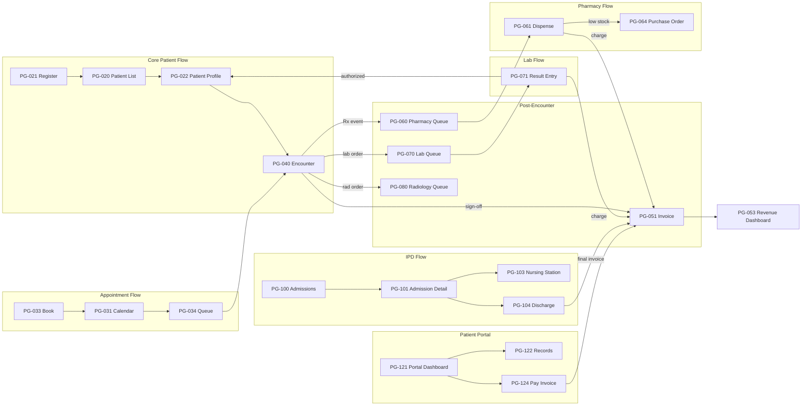

# Pages Bible — Part 5: IPD, HR, Portal, Settings & Audit

> Final part. Cross-referenced against: `openapi-phase2.yaml`, `openapi-phase3.yaml`, `04-screens-phase2-3.md`

---

## 11. IPD (Inpatient) Module (Phase 2)

### PG-100 · Active Admissions

| Property | Value |
|----------|-------|
| **Route** | `/ipd/admissions` |
| **Shell** | IPD |
| **Access** | DOCTOR, NURSE, FACILITY_ADMIN |
| **API** | `GET /ipd/admissions?status=active&facility_id=` |

**Layout:**
```
┌─────────────────────────────────────────────────────────────┐
│  Active Admissions (12)                    [+ Admit Patient] │
├────────┬──────────┬──────┬──────┬────────┬────────┬────────┤
│ Adm #  │ Patient  │ Ward │ Bed  │ Doctor │ Since  │ Days   │
├────────┼──────────┼──────┼──────┼────────┼────────┼────────┤
│ ADM-12 │ Ahmed B. │ ICU  │ ICU-3│ Dr. Y  │ 12 Apr │ 3      │
│ ADM-11 │ Sara M.  │ WardA│ A-05 │ Dr. A  │ 10 Apr │ 5      │
│ ADM-10 │ Omar K.  │ WardB│ B-02 │ Dr. Y  │ 14 Apr │ 1      │
└────────┴──────────┴──────┴──────┴────────┴────────┴────────┘
Actions: [View] [Transfer Bed] [Discharge]
```

---

### PG-101 · Admission Detail

| Route | `/ipd/admissions/[admissionId]` |
|-------|--------------------------------|

**Layout:**
```
┌─────────────────────────────────────────────────────────────┐
│  ← Admissions    ADM-2026-00012                              │
├─────────────────────────────────────────────────────────────┤
│  STICKY HEADER                                               │
│  👤 Ahmed Benali │ CEA-2026-001 │ Ward: ICU │ Bed: ICU-3    │
│  Doctor: Dr. Youssef │ Admitted: 12 Apr │ Day 3             │
│  ⚠️ Allergies: 🔴 Penicillin                                │
├─────────────────────────────────────────────────────────────┤
│  [Overview] [Rounds] [Vitals] [Medications] [Orders] [Billing]│
├─────────────────────────────────────────────────────────────┤
│  ── Tab: Overview ───                                        │
│  Admission reason: Post-operative monitoring                 │
│  Primary diagnosis: K35.8 Acute appendicitis                │
│  Current vitals (latest): BP 130/82 │ HR 78 │ Temp 37.1    │
│                                                              │
│  ── Tab: Rounds (daily progress notes) ───                  │
│  ┌────────────────────────────────────────────────────────┐  │
│  │ Day 3 — 14 Apr 08:00 — Dr. Youssef                    │  │
│  │ S: Patient reports less pain, ambulating well          │  │
│  │ O: Wound clean, no signs of infection                  │  │
│  │ A: Recovery progressing well                           │  │
│  │ P: Continue current meds, plan discharge tomorrow      │  │
│  └────────────────────────────────────────────────────────┘  │
│  [+ Add Round Note]                                          │
│                                                              │
│  ── Tab: Vitals ── (nurse-entered, chart view)              │
│  [📊 BP trend chart] [📊 Temperature chart] [📊 SpO2 chart]│
│  Table: Time │ BP │ HR │ Temp │ SpO2 │ Recorded by          │
│                                                              │
│  ── Tab: Medications (scheduled) ──                         │
│  ┌────┬──────────────┬──────┬──────┬─────────┬─────────────┐│
│  │Time│ Drug         │ Dose │ Route│ Status  │ Administered ││
│  ├────┼──────────────┼──────┼──────┼─────────┼─────────────┤│
│  │08:00│Amoxicillin  │500mg │ Oral │✅ Given │Nurse Khadija ││
│  │08:00│Metformin    │850mg │ Oral │✅ Given │Nurse Khadija ││
│  │14:00│Amoxicillin  │500mg │ Oral │⏳ Due   │              ││
│  │20:00│Amoxicillin  │500mg │ Oral │📅 Later │              ││
│  └────┴──────────────┴──────┴──────┴─────────┴─────────────┘│
│                                                              │
│  ── Tab: Billing ── (bed charges + services)                │
│  Bed charge: ICU × 3 days × 500 MAD/day = 1,500 MAD        │
│  Services: Surgery 5,000 + Meds 800 = 5,800 MAD            │
│  Total: 7,300 MAD    [View Invoice]                          │
│                                                              │
│  Actions: [Transfer Bed] [Discharge Patient]                │
└─────────────────────────────────────────────────────────────┘
```

---

### PG-102 · Bed Map

| Route | `/ipd/beds` |
|-------|-------------|

**Layout:**
```
Ward: [All ▾] [ICU] [Ward A] [Ward B] [Maternity]

ICU (4 beds — 75% occupancy)
┌────────┐ ┌────────┐ ┌────────┐ ┌────────┐
│ ICU-1  │ │ ICU-2  │ │ ICU-3  │ │ ICU-4  │
│ 🟢 Free│ │ 🔴 Occ │ │ 🔴 Occ │ │ 🟡 Maint│
│        │ │ Sara M.│ │ Ahmed B│ │        │
│ [Admit]│ │ Day 5  │ │ Day 3  │ │        │
└────────┘ └────────┘ └────────┘ └────────┘

Ward A (8 beds — 50% occupancy)
┌─────┐ ┌─────┐ ┌─────┐ ┌─────┐ ┌─────┐ ┌─────┐ ┌─────┐ ┌─────┐
│A-01 │ │A-02 │ │A-03 │ │A-04 │ │A-05 │ │A-06 │ │A-07 │ │A-08 │
│🟢   │ │🟢   │ │🔴   │ │🟢   │ │🔴   │ │🟢   │ │🟢   │ │🟢   │
└─────┘ └─────┘ └─────┘ └─────┘ └─────┘ └─────┘ └─────┘ └─────┘

Legend: 🟢 Available  🔴 Occupied  🟡 Maintenance
Click bed → patient card or [Admit] action
```

**Responsive:** Grid on desktop, list view on mobile (<768px).

---

### PG-103 · Nursing Station

| Route | `/ipd/nursing-station` |
|-------|------------------------|
| **Access** | NURSE |

**Layout:** Per-patient task cards for the shift. Each card shows: patient name, bed, pending tasks (vitals due, medications to administer, doctor orders). Tasks sorted by urgency/time. Checkboxes to mark completed. See Part 1 user journey (Nurse Khadija) for full flow.

### PG-104 · Discharge

| Route | `/ipd/discharge/[admissionId]` |
|-------|-------------------------------|

**Layout:** Discharge summary form: discharge diagnosis, condition at discharge, follow-up instructions, medication on discharge, diet instructions. PDF generation for patient. Triggers: final invoice, bed freed, patient notified.

---

## 12. HR Module (Phase 3)

### PG-110 · Staff Directory

| Route | `/hr/staff` |
|-------|-------------|

Table: Name, Role, Department, Facility, Status, Phone, Email. Filters: role, department, facility, status. Click → Staff Detail (profile, schedule, HR docs, attendance history).

### PG-111 · Attendance Dashboard

| Route | `/hr/attendance` |
|-------|-------------------|

Calendar heatmap per staff member. Check-in/out tracking. Late arrivals highlighted. Monthly summary cards: present, absent, late, leave.

### PG-112 · Leave Management

| Route | `/hr/leave` |
|-------|-------------|

Leave requests table (staff, type, dates, status). Approval workflow: submit → manager reviews → approve/reject. Calendar overlay showing who's on leave.

### PG-113 · Payroll

| Route | `/hr/payroll` |
|-------|---------------|

Monthly payroll generator: select month → calculate (base + overtime - deductions). Payslip PDF per staff member. Batch approval and payment tracking.

---

## 13. Patient Portal (Phase 2)

### PG-120 · Portal Login

| Route | `/portal/login` |
|-------|-----------------|
| **API** | `POST /portal/auth/otp-request`, `POST /portal/auth/otp-verify` |

**Layout:**
```
┌──────────────────────────────────────┐
│     [MediCore Logo]                   │
│     Access Your Health Records        │
│                                       │
│     Phone number:                     │
│     [+212 ▾] [6XX XXX XXX         ]  │
│     [Send OTP Code (primary)]         │
│                                       │
│     ── After OTP sent ──              │
│     Enter the 6-digit code            │
│     [_ _ _ _ _ _]                     │
│     Resend in 58s                     │
│     [Verify & Login]                  │
└──────────────────────────────────────┘
```

No password — OTP only for patients. Simple, mobile-optimized.

---

### PG-121 · Portal Dashboard

| Route | `/portal/dashboard` |
|-------|---------------------|

**Layout:**
```
Welcome, Fatima 👋

┌───────────────┐ ┌──────────────────┐ ┌──────────────────┐
│ 📅 Next Appt  │ │ 💰 Outstanding   │ │ 📋 Last Visit    │
│ 18 Apr, 09:00 │ │ 500 MAD          │ │ 12 Apr — Dr. Y   │
│ Dr. Youssef   │ │ [Pay Now]        │ │ [View]           │
└───────────────┘ └──────────────────┘ └──────────────────┘

Quick Actions: [Book Appointment] [View Records] [Pay Invoice]

Recent Activity:
│ 📅 Appointment booked for 18 Apr
│ 🔬 Lab results available — HbA1c
│ 💰 Invoice INV-042 received — 500 MAD
```

**UX:** Drastically simpler than staff views. No jargon. Large touch targets. Mobile-first.

---

### PG-122–125 · My Records, My Appointments, My Invoices, Settings

Already specified in `04-screens-phase2-3.md` S52-S55. Key additions from CodeCanyon audit:
- **My Records:** Download prescription PDF, view lab results with normal range indicators
- **My Appointments:** Cancel/reschedule with optional reason, see queue position after check-in
- **My Invoices:** Pay via Stripe, download receipt PDF
- **Settings:** Notification preferences, AI consent toggle, data export request (GDPR), delete account request

---

## 14. Settings & Admin Pages

### PG-130 · Organization Settings

| Route | `/admin/settings` |
|-------|-------------------|

**Sub-pages/tabs:**

| Tab | Contents |
|-----|----------|
| **General** | Org name, logo upload, footer text (for print headers), timezone, currency, language |
| **Branding** | Logo, primary color override, clinic website hero image |
| **Communication** | SMS provider (Twilio keys), email provider (SendGrid), notification templates |
| **Billing** | Default tax %, service catalog link, discount rules, payment methods enabled, Stripe keys |
| **Modules** | Toggle switches: Lab, Pharmacy, Portal, IPD, Radiology, Telemedicine, HR (P2) |
| **Security** | Password policy, session timeout, 2FA settings (future), IP whitelist (future) |

**UX Rules:**
- ✅ Audit who changed settings and when (settings change log)
- ✅ Confirmation modal on sensitive ops (disable module with existing data)
- ✅ Logo upload: preview + crop, stored in R2, used on print headers + portal

---

### PG-131 · Team / User Management

| Route | `/admin/team` |
|-------|---------------|

**Layout:**
```
┌─────────────────────────────────────────────────────────────┐
│  Team (24 members)                        [+ Invite Member]  │
├─────────────────────────────────────────────────────────────┤
│  Filters: [All roles ▾] [All facilities ▾] [Active ▾]      │
├──────────┬──────────┬────────────┬───────────┬──────┬──────┤
│ Name     │ Email    │ Role       │ Facility  │Status│ Last │
├──────────┼──────────┼────────────┼───────────┼──────┼──────┤
│ Dr. Y    │ y@...    │ 🩺 DOCTOR  │ Ain Diab  │🟢 Act│Today │
│ Khadija  │ k@...    │ 👩‍⚕️ NURSE  │ Ain Diab  │🟢 Act│Today │
│ Salma    │ s@...    │ 💼 RECEPT  │ Maarif    │🟢 Act│Yest. │
└──────────┴──────────┴────────────┴───────────┴──────┴──────┘

[+ Invite Member] → Modal:
  Email, Role [▾], Facility [▾], "Send invite email"

Click user → User Detail:
  Profile info, role/permissions, activity log (recent actions),
  "Effective permissions" preview, suspend/reactivate actions
```

**API Gaps:**
```yaml
GET /users/{id}/activity    # NEW — recent actions log for user detail
GET /roles/{id}/permissions # NEW — effective permissions for role preview
POST /users/invite          # EXISTS in concept but needs email invite flow
```

---

### PG-132 · Audit Log

| Route | `/admin/audit-log` |
|-------|---------------------|

**Layout:**
```
┌───────────┬──────────┬──────────┬────────────┬─────────────┐
│ Timestamp │ User     │ Resource │ Action     │ Summary     │
├───────────┼──────────┼──────────┼────────────┼─────────────┤
│ 08:15:42  │ Dr. Y    │ Encounter│ sign_off   │ Enc #E-042  │
│ 08:14:30  │ Nurse K  │ Vitals   │ update     │ BP changed  │
│ 08:10:12  │ Recept S │ Patient  │ create     │ CEA-2026-048│
│ 08:05:01  │ Admin O  │ Settings │ update     │ Tax % → 20% │
└───────────┴──────────┴──────────┴────────────┴─────────────┘

Filters: [User ▾] [Entity type ▾] [Action ▾] [Date range] [Facility ▾]
Click row → Field-level diff (old value vs new value)
Export: [CSV] [PDF] for compliance audits
```

---

### PG-133 · Reports Center

| Route | `/admin/reports` |
|-------|-------------------|

**Layout:**
```
Reports (categorized)

Clinical:        [Patient Summary] [Encounter Stats] [Diagnosis Frequency]
Operational:     [Appointment Analysis] [Queue Wait Times] [No-show Rate]
Financial:       [Revenue by Service] [Revenue by Doctor] [Aging Report]
Inventory:       [Stock Levels] [Expiry Report] [Usage Report]
Audit:           [User Activity] [Settings Changes] [Login History]

Each report: Filter panel + Table/Chart + [Export CSV] [Export PDF]
Saved filters per user (localStorage + server for premium)
```

---

## 15. Cross-Cutting: Page Relations Map



---

## 16. Complete Page Count (Final)

| Category | Pages | Phase |
|----------|-------|-------|
| Auth & Onboarding | 8 (PG-001–008) | 1 |
| Global Layout | 6 (PG-009–014) | 1 |
| Patient Management | 3 (PG-020–022) | 1 |
| Appointments | 6 (PG-030–035) | 1 |
| Encounters/EMR | 4 (PG-040–043) | 1 |
| Billing | 4 (PG-050–053) | 1 |
| Pharmacy | 6 (PG-060–065) | 2 |
| Lab | 3 (PG-070–072) | 2 |
| Radiology | 3 (PG-080–082) | 2 |
| Inventory | 5 (PG-090–094) | 2 |
| IPD | 5 (PG-100–104) | 2 |
| HR | 4 (PG-110–113) | 3 |
| Patient Portal | 6 (PG-120–125) | 2 |
| Settings & Admin | 4 (PG-130–133) | 1-2 |
| **Total unique pages** | **67** | |
| + Modals/drawers | ~15 | |
| + Sub-components | ~20 | |
| **Grand total surfaces** | **~102** | |

---

## 17. Master API Gap Summary (All Parts)

### Phase 1 (MVP) — Must Add

| Endpoint | Used By |
|----------|---------|
| `POST /auth/forgot-password` | PG-002 |
| `POST /auth/reset-password` | PG-003 |
| `GET /orgs/check-slug/{slug}` | PG-004 |
| `PUT /patients/{id}` | PG-021 |
| `DELETE /patients/{id}/allergies/{allergyId}` | PG-021 |
| `GET /patients/{id}/timeline` | PG-022 |
| `GET /doctors/{id}/schedule` (list) | PG-030 |
| `PUT /appointments/{id}` (reschedule) | PG-032 |
| `POST /encounters/{id}/lab-orders` | PG-040 |
| `GET /drugs/search?q=` | PG-042 |
| `GET /icd10/search?q=` | PG-040 |
| `POST /invoices` (manual) | PG-050 |
| `POST /invoices/{id}/void` | PG-051 |
| `GET /invoices/{id}/pdf` | PG-051 |
| `GET /notifications` | PG-009 |

### Phase 2 — Must Add

| Endpoint | Used By |
|----------|---------|
| `GET /patients/{id}/documents` + `POST` | PG-022 |
| `GET /patients/{id}/vitals-trend` | PG-022 |
| `GET /appointments/{id}/audit` | PG-032 |
| `GET /order-sets` | PG-040 |
| `POST /encounters/{id}/amend` | PG-043 |
| `GET /orgs/{id}/revenue/by-service` | PG-053 |
| `GET /orgs/{id}/revenue/by-doctor` | PG-053 |
| `GET /reports/export` | PG-133 |
| `GET /users/{id}/activity` | PG-131 |
| `GET /super/tenants` | PG-011 |

**Total new endpoints identified: 25** (15 MVP, 10 Phase 2)

---

> All 5 parts complete. The Pages Bible is ready at:
> - `04-pages-bible-part1.md` — Auth, Onboarding, Global Layout
> - `04-pages-bible-part2.md` — Patient Management, Appointments
> - `04-pages-bible-part3.md` — Encounters/EMR, Billing
> - `04-pages-bible-part4.md` — Pharmacy, Lab, Radiology, Inventory
> - `04-pages-bible-part5.md` — IPD, HR, Portal, Settings, Relations Map
