# Phase 2 & 3 — Information Architecture & Screen Inventory

## MediCore HIS — All Routes, Screens & Navigation (Full Product)

> Extends `04-information-architecture.md` and `04-screen-inventory.md`.

---

## 1. Full Site Map (All Phases)

```mermaid
graph TB
    ROOT["medicore.app"]

    ROOT --> AUTH["/(auth)"]
    ROOT --> ADMIN["/(admin)"]
    ROOT --> CLINICAL["/(clinical)"]
    ROOT --> OPS["/(ops)"]
    ROOT --> LAB_SHELL["/(lab) — P2"]
    ROOT --> PHARMA_SHELL["/(pharmacy) — P2"]
    ROOT --> RAD_SHELL["/(radiology) — P2"]
    ROOT --> IPD_SHELL["/(ipd) — P2"]
    ROOT --> HR_SHELL["/(hr) — P3"]
    ROOT --> PORTAL_SHELL["/(portal) — P2"]
    ROOT --> CMS_PUBLIC["/(cms) — P2"]
    ROOT --> PUBLIC["/(public)"]

    ADMIN --> A1["/admin/dashboard"]
    ADMIN --> A2["/admin/team"]
    ADMIN --> A3["/admin/facilities"]
    ADMIN --> A4["/admin/services"]
    ADMIN --> A5["/admin/analytics"]
    ADMIN --> A6["/admin/audit-log"]
    ADMIN --> A7["/admin/settings"]
    ADMIN --> A8["/admin/modules — P2"]
    ADMIN --> A9["/admin/backup — P2"]
    ADMIN --> A10["/admin/campaigns — P2"]
    ADMIN --> A11["/admin/cms — P2"]
    ADMIN --> A12["/admin/custom-fields — P2"]
    ADMIN --> A13["/admin/workflows — P3"]
    ADMIN --> A14["/admin/translations — P2"]

    CLINICAL --> C1["/clinical/patients"]
    CLINICAL --> C2["/clinical/patients/[id]"]
    CLINICAL --> C3["/clinical/patients/[id]/encounters/[encId]"]
    CLINICAL --> C4["/clinical/messaging — P2"]
    CLINICAL --> C5["/clinical/telemedicine/[sessionId] — P2"]

    OPS --> O1["/ops/patients"]
    OPS --> O2["/ops/patients/new"]
    OPS --> O3["/ops/appointments"]
    OPS --> O4["/ops/queue"]
    OPS --> O5["/ops/billing"]
    OPS --> O6["/ops/billing/[invoiceId]"]
    OPS --> O7["/ops/inventory — P2"]
    OPS --> O8["/ops/messaging — P2"]

    LAB_SHELL --> L1["/lab/queue"]
    LAB_SHELL --> L2["/lab/orders/[orderId]"]
    LAB_SHELL --> L3["/lab/catalog"]
    LAB_SHELL --> L4["/lab/reports"]

    PHARMA_SHELL --> PH1["/pharmacy/queue"]
    PHARMA_SHELL --> PH2["/pharmacy/dispense/[rxId]"]
    PHARMA_SHELL --> PH3["/pharmacy/inventory"]
    PHARMA_SHELL --> PH4["/pharmacy/drugs"]
    PHARMA_SHELL --> PH5["/pharmacy/purchase-orders"]
    PHARMA_SHELL --> PH6["/pharmacy/suppliers"]

    RAD_SHELL --> R1["/radiology/queue"]
    RAD_SHELL --> R2["/radiology/orders/[orderId]"]
    RAD_SHELL --> R3["/radiology/catalog"]
    RAD_SHELL --> R4["/radiology/viewer/[studyId] — DICOM"]

    IPD_SHELL --> I1["/ipd/admissions"]
    IPD_SHELL --> I2["/ipd/admissions/[admissionId]"]
    IPD_SHELL --> I3["/ipd/wards"]
    IPD_SHELL --> I4["/ipd/beds"]
    IPD_SHELL --> I5["/ipd/nursing-station"]
    IPD_SHELL --> I6["/ipd/rounds/[admissionId]"]
    IPD_SHELL --> I7["/ipd/discharge/[admissionId]"]

    HR_SHELL --> H1["/hr/staff"]
    HR_SHELL --> H2["/hr/attendance"]
    HR_SHELL --> H3["/hr/leave"]
    HR_SHELL --> H4["/hr/payroll"]
    HR_SHELL --> H5["/hr/reports"]

    PORTAL_SHELL --> PT1["/portal/login"]
    PORTAL_SHELL --> PT2["/portal/dashboard"]
    PORTAL_SHELL --> PT3["/portal/records"]
    PORTAL_SHELL --> PT4["/portal/appointments"]
    PORTAL_SHELL --> PT5["/portal/invoices"]
    PORTAL_SHELL --> PT6["/portal/settings"]

    CMS_PUBLIC --> CM1["/[orgSlug] — public clinic page"]
    CMS_PUBLIC --> CM2["/[orgSlug]/book — public booking"]

    PUBLIC --> PUB1["/queue-display/[facilityId]"]
    PUBLIC --> PUB2["/widget/[orgSlug] — embeddable booking"]
    PUBLIC --> PUB3["/triage/[orgSlug] — chatbot P2"]
```



---

## 2. New Navigation Sidebars (Phase 2/3)

### Lab Sidebar (LAB_TECH, DOCTOR)
```
📋 Pending Orders (queue)
🔬 Enter Results
📊 Lab Catalog
📄 Reports
```

### Pharmacy Sidebar (PHARMACIST)
```
💊 Dispensing Queue
📦 Inventory
💊 Drug Catalog
📋 Purchase Orders
🏢 Suppliers
```

### Radiology Sidebar (RADIOLOGIST)
```
📋 Pending Orders
📝 Enter Reports
📊 Test Catalog
🖼️ DICOM Viewer
```

### IPD Sidebar (DOCTOR, NURSE, FACILITY_ADMIN)
```
🏥 Active Admissions
🛏️ Bed Map
🏢 Wards
👩‍⚕️ Nursing Station
📝 Round Notes
📋 Discharge
```

### HR Sidebar (HR_MANAGER, ORG_ADMIN)
```
👥 Staff Directory
📅 Attendance
📝 Leave Requests
💰 Payroll
📊 Reports
```

### Portal Sidebar (PATIENT — patient portal)
```
🏠 Dashboard
📋 My Records
📅 Appointments
💰 Invoices
⚙️ Settings
```

### Admin Sidebar Expansion (P2 additions)
```
📊 Dashboard
👥 Team
🏥 Facilities
📋 Services Catalog
📈 Analytics
📜 Audit Log
⚙️ Settings
── Phase 2 ──
🧩 Modules          (toggle modules per org)
🌐 Translations     (i18n management)
📢 Campaigns        (SMS/email bulk)
🌍 CMS Pages        (clinic website builder)
📝 Custom Fields     (entity customization)
💾 Backup/Restore
── Phase 3 ──
⚡ Workflows        (automation engine)
```

---

## 3. Phase 2 Screen Inventory

### Patient Portal (6 screens)

| # | Screen | Route | States | Key Components |
|---|--------|-------|--------|----------------|
| S50 | Portal Login | `/portal/login` | phone_input, otp_sent, otp_verify, otp_error, logged_in | Phone input, OTP code input, timer (resend in 60s) |
| S51 | Portal Dashboard | `/portal/dashboard` | loading, populated, empty | Welcome card, upcoming appointments, recent encounters, unpaid invoices |
| S52 | My Records | `/portal/records` | loading, encounters_list, encounter_detail | Encounter timeline, vitals summary, diagnoses, prescriptions (download PDF) |
| S53 | My Appointments | `/portal/appointments` | loading, list, booking_flow (select facility → doctor → slot → confirm) | Appointment list, "Book New" CTA, cancel/reschedule buttons |
| S54 | My Invoices | `/portal/invoices` | loading, list, payment_form, payment_success | Invoice list, status badges, "Pay Now" → Stripe form, receipt download |
| S55 | Portal Settings | `/portal/settings` | loading, form | Notification toggles (SMS, email), AI consent toggle, data export request, delete account request |

### Lab Module (4 screens)

| # | Screen | Route | States | Key Components |
|---|--------|-------|--------|----------------|
| S60 | Lab Orders Queue | `/lab/queue` | loading, populated, empty, filtered | Orders table (patient, tests, status, urgency), filter by status, "Enter Results" action |
| S61 | Lab Order Detail | `/lab/orders/[orderId]` | loading, specimen_pending, entering_results, submitted, authorized | Test list, specimen tracking, result entry form per test, normal range indicator, abnormal flag, authorize button |
| S62 | Lab Catalog | `/lab/catalog` | loading, populated, create_modal, edit_modal | Tests table (name, category, specimen type, normal ranges, price), CRUD |
| S63 | Lab Reports | `/lab/reports` | loading, populated | Completed orders, PDF generation, date filter |

### Pharmacy Module (6 screens)

| # | Screen | Route | States | Key Components |
|---|--------|-------|--------|----------------|
| S70 | Dispensing Queue | `/pharmacy/queue` | loading, populated, empty | Pending Rx list (patient, drug, dosage, status), "Dispense" action |
| S71 | Dispense Detail | `/pharmacy/dispense/[rxId]` | loading, verifying, dispensing, complete | Rx details, drug info, stock check, quantity input, batch selector, confirm button |
| S72 | Pharmacy Inventory | `/pharmacy/inventory` | loading, populated, filtered, alerts | Stock table (drug, batch, expiry, qty, reorder level), low-stock/expiring badges |
| S73 | Drug Catalog | `/pharmacy/drugs` | loading, populated, create_modal, edit_modal | Drugs table (name, form, strength, price, stock status), CRUD |
| S74 | Purchase Orders | `/pharmacy/purchase-orders` | loading, list, create_form, detail | PO list, create PO form (select drugs, quantities), approval workflow |
| S75 | Suppliers | `/pharmacy/suppliers` | loading, populated, create_modal | Supplier table (name, contact, phone), CRUD |

### Telemedicine (3 screens)

| # | Screen | Route | States | Key Components |
|---|--------|-------|--------|----------------|
| S80 | Video Consultation (Doctor) | `/clinical/telemedicine/[sessionId]` | loading, waiting_for_patient, in_session, ended | Video feed (Daily.co), encounter sidebar, end call button |
| S81 | Video Consultation (Patient) | `/portal/telemedicine/[sessionId]` | loading, waiting_room, in_session, ended | Video feed, "Doctor will join shortly" message, leave button |
| S82 | Telemedicine Settings | (admin sub-page) | form | Daily.co API key, default settings, recording toggle |

### IPD Module (7 screens)

| # | Screen | Route | States | Key Components |
|---|--------|-------|--------|----------------|
| S90 | Active Admissions | `/ipd/admissions` | loading, populated, empty | Admissions table (patient, ward, bed, status, duration), "Admit" button |
| S91 | Admission Detail | `/ipd/admissions/[admissionId]` | loading, active, discharged | Patient summary, bed info, round notes timeline, medication schedule, vitals chart, "Transfer Bed" and "Discharge" |
| S92 | Ward Management | `/ipd/wards` | loading, populated, create_modal | Ward cards (name, type, bed count, occupancy %), CRUD |
| S93 | Bed Map | `/ipd/beds` | loading, populated | Visual bed grid per ward: green=available, red=occupied, yellow=maintenance |
| S94 | Nursing Station | `/ipd/nursing-station` | loading, populated | Today's tasks: vital checks, medication to administer, doctor orders. Per-patient cards |
| S95 | Round Notes | `/ipd/rounds/[admissionId]` | loading, populated, new_note_form | Daily progress notes form (doctor), vitals entry, orders |
| S96 | Discharge | `/ipd/discharge/[admissionId]` | loading, form, preview, confirmed | Discharge summary form, follow-up instructions, medication instructions, PDF generation |

### Inventory Module (5 screens)

| # | Screen | Route | States | Key Components |
|---|--------|-------|--------|----------------|
| S100 | Inventory Dashboard | `/ops/inventory` | loading, populated, alerts | Item list, stock levels, low-stock alerts, quick adjust |
| S101 | Item Catalog | `/ops/inventory/catalog` | loading, populated, create_modal | Items table (name, category, unit, qty, reorder), CRUD |
| S102 | Stock Transaction | `/ops/inventory/transactions` | loading, populated, new_transaction | Transaction log, receive/issue/adjust form |
| S103 | Purchase Orders | `/ops/inventory/purchase-orders` | loading, list, create, detail | PO flow: create → approve → mark received |
| S104 | Supplier Management | `/ops/inventory/suppliers` | loading, populated | Same as pharmacy suppliers (shared module) |

### Radiology Module (4 screens)

| # | Screen | Route | States | Key Components |
|---|--------|-------|--------|----------------|
| S110 | Radiology Queue | `/radiology/queue` | loading, populated | Pending orders, "Enter Report" action |
| S111 | Report Entry | `/radiology/orders/[orderId]` | loading, reporting, submitted, authorized | Report form (findings, impression, conclusion), template picker, image upload, authorize button |
| S112 | Radiology Catalog | `/radiology/catalog` | loading, populated | Test types table (name, body parts, price), CRUD |
| S113 | DICOM Viewer | `/radiology/viewer/[studyId]` | loading, loaded, error | Orthanc-embedded DICOM viewer (iframe or Cornerstone.js) |

### Messaging (3 screens)

| # | Screen | Route | States | Key Components |
|---|--------|-------|--------|----------------|
| S120 | Inbox | `/clinical/messaging` or `/ops/messaging` | loading, populated, empty | Conversation list (sidebar), message thread (main), compose button |
| S121 | Conversation Detail | (same route, selected conv) | loading, messages_loaded, typing | Message bubbles, text input, attachment button, patient link |
| S122 | New Conversation | (modal) | select_recipient, compose | User search, patient link (optional), "Create Group" option |

### Admin Expansion (P2)

| # | Screen | Route | States | Key Components |
|---|--------|-------|--------|----------------|
| S130 | Module Configuration | `/admin/modules` | loading, form | Toggle switches per module, feature descriptions |
| S131 | Custom Fields Manager | `/admin/custom-fields` | loading, populated, create_modal | Entity type selector, field list, drag-to-reorder, CRUD |
| S132 | CMS Page Builder | `/admin/cms` | loading, list, editor | Page list, WYSIWYG section editor (drag sections: hero, services, doctors, contact), preview |
| S133 | Campaign Builder | `/admin/campaigns` | loading, list, create_wizard | Audience filter (facility, patient tags), message template, schedule, analytics |
| S134 | Translation Manager | `/admin/translations` | loading, table | Language selector, key:value table with search, import/export |
| S135 | Backup Manager | `/admin/backup` | loading, history, backup_running | Backup history table, "Create Backup" button, restore request |

### Other Public/Widget Screens (P2)

| # | Screen | Route | States | Key Components |
|---|--------|-------|--------|----------------|
| S140 | Public Clinic Page | `/[orgSlug]` | loading, rendered | Auto-generated clinic page: hero, services, doctors, hours, contact, "Book Now" |
| S141 | Online Booking Widget | `/widget/[orgSlug]` | loading, select_specialty, select_doctor, select_slot, confirm, success | Embeddable widget (iframe), step-by-step booking |
| S142 | Triage Chatbot | `/triage/[orgSlug]` | loading, symptom_input, questions, result, book_recommended | Chat interface, symptom cards, urgency result (R/A/G), "Book Appointment" CTA |

---

## Phase 3 Screens (HR + Workflow + Analytics)

| # | Screen | Route | Screens |
|---|--------|-------|---------|
| S150-S156 | HR Module | `/hr/*` | Staff directory, Attendance dashboard, Leave calendar, Payroll generator, Reports |
| S160-S163 | Workflow Engine | `/admin/workflows/*` | Workflow list, Rule builder (simple), Visual canvas builder, Execution log |
| S165-S166 | AI Advanced | `/admin/analytics/*` | Schedule optimizer, Population health dashboard |
| S170-S172 | Ambulance | `/ops/ambulance/*` | Fleet management, Dispatch board, Billing |

---

## 4. Complete Screen Count

| Category | Phase 1 | Phase 2 | Phase 3 | Total |
|----------|---------|---------|---------|-------|
| Auth | 6 | — | — | 6 |
| Admin | 7 | 6 | 4 | 17 |
| Clinical | 3 | 2 | — | 5 |
| Operations | 8 | 5 | 3 | 16 |
| Lab | — | 4 | — | 4 |
| Pharmacy | — | 6 | — | 6 |
| Radiology | — | 4 | — | 4 |
| IPD | — | 7 | — | 7 |
| Patient Portal | — | 6 | — | 6 |
| Telemedicine | — | 3 | — | 3 |
| Messaging | — | 3 | — | 3 |
| Public/Widget | 1 | 3 | — | 4 |
| HR | — | — | 5 | 5 |
| Workflow | — | — | 4 | 4 |
| Mobile (native) | — | — | ~15 | 15 |
| **Total** | **25** | **49** | **31** | **105** |
