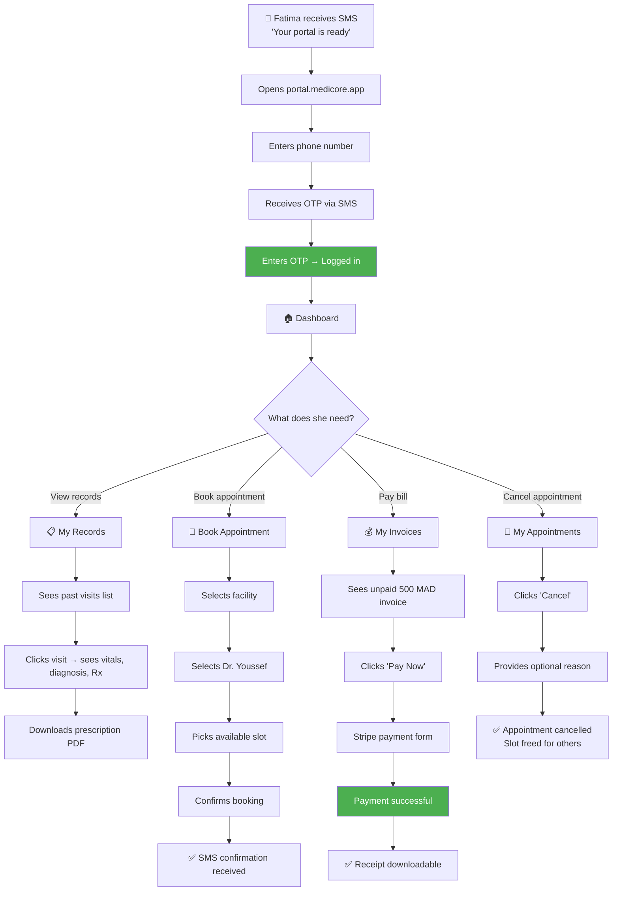
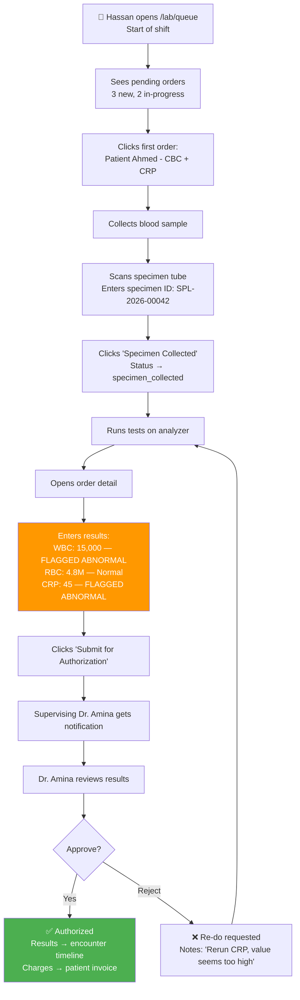
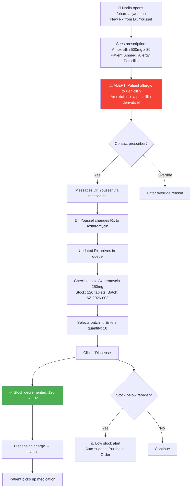
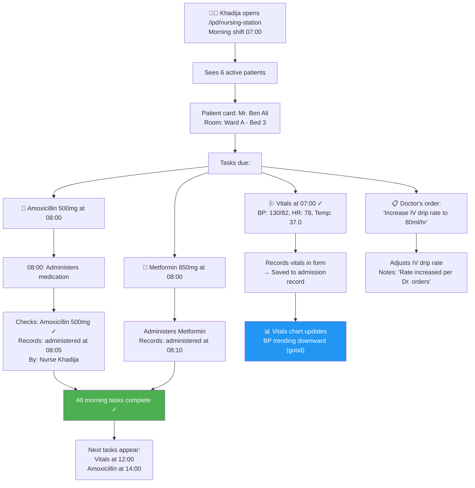
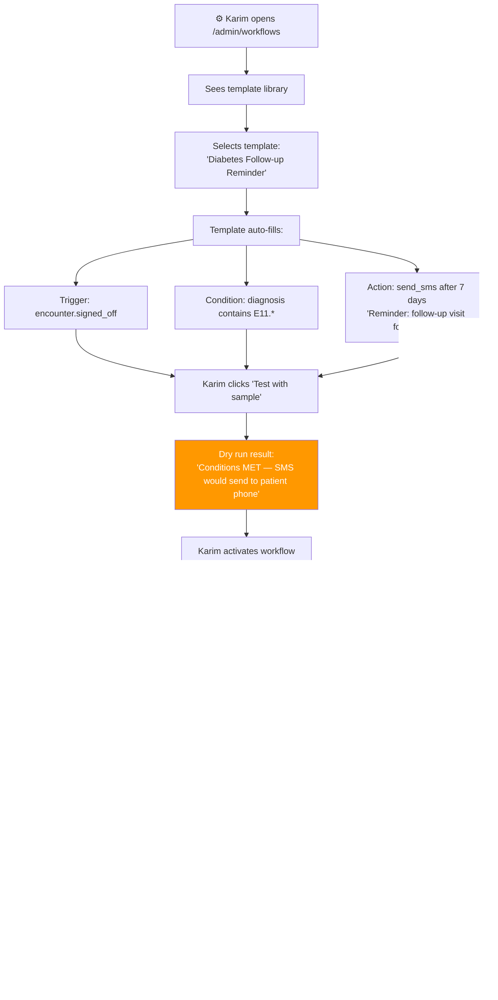
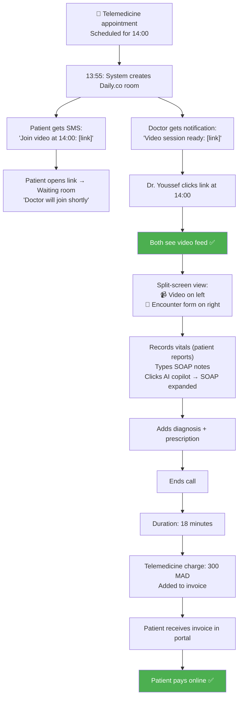

# Phase 2 & 3 — User Journey Maps

## MediCore HIS — Extended Journey Maps for New Personas

---

## 1. Patient (Fatima) — Portal Self-Service Journey

**Touchpoints**: SMS, Web Portal, Stripe
**Pain Points Addressed**: No phone calls to clinic, no waiting, no cash-only constraints
**Emotions**: Empowered (self-service), Relieved (transparent billing), Confident (can see own records)

---

## 2. Lab Technician (Hassan) — Lab Order to Result Journey

**Touchpoints**: Lab queue dashboard, specimen scanner, result entry form
**Pain Points Addressed**: No paper lab sheets, auto-abnormal flagging, authorized before visible to patient
**Emotions**: Efficient (structured workflow), Confident (abnormal flags catch errors)

---

## 3. Pharmacist (Nadia) — Dispensing Journey

**Touchpoints**: Pharmacy queue, allergy checker, stock manager, messaging
**Pain Points Addressed**: Allergy cross-checking prevents harm, auto stock alerts prevent stockouts
**Emotions**: Safe (allergy checks), Proactive (automated restock suggestions)

---

## 4. Nurse (Khadija) — IPD Nursing Station Journey

**Touchpoints**: Nursing station dashboard, vitals entry, medication log
**Pain Points Addressed**: No paper medication charts, no missed medications (timed tasks), vitals trend visible
**Emotions**: Organized (clear task list), Accountable (everything timestamped)

---

## 5. Admin (Karim) — Workflow Automation Journey (Phase 3)

**Touchpoints**: Workflow builder, template library, execution log
**Pain Points Addressed**: Manual follow-up calls eliminated, consistent patient outreach
**Emotions**: Powerful (automation), In-control (execution log proves it works)

---

## 6. Doctor (Dr. Youssef) — Telemedicine Journey

**Touchpoints**: Video room, encounter sidebar, portal billing
**Pain Points Addressed**: Remote patients served, no travel, integrated documentation during call
**Emotions**: Modern (video consultation), Efficient (encounter + video in one screen)
