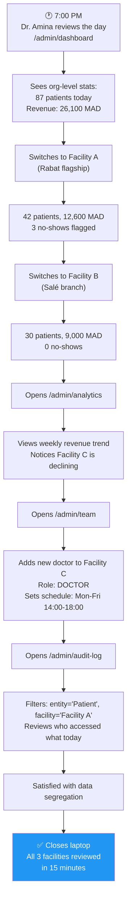

# Phase 4 — User Journey Maps

## MediCore HIS — Per-Persona User Journeys

---

## Journey 1: Dr. Youssef — Solo Practitioner First Day

```mermaid
flowchart TD
    A["🌐 Discovers MediCore<br/>LinkedIn post or word of mouth"] --> B["📝 Signs up<br/>medicore.app/onboarding"]
    B --> C{"Onboarding Wizard<br/>(4 steps)"}
    C --> D["1. Create Org<br/>Name: 'Cabinet Dr. El Amrani'<br/>MRN prefix: 'CEA'"]
    D --> E["2. Create Facility<br/>Name: 'Ain Diab Clinic'<br/>Address, phone"]
    E --> F["3. Create Admin Account<br/>Email + password"]
    F --> G["4. Create Doctor Profile<br/>Specialty, license no."]
    G --> H["✅ Dashboard loads<br/>Empty state: 'Add your schedule'"]

    H --> I["Sets weekly schedule<br/>Mon-Fri 9:00-13:00, 15:00-18:00<br/>15-min slots"]
    I --> J["Adds services catalog<br/>Consultation: 300 MAD"]

    J --> K["📞 First patient calls"]
    K --> L["Books appointment<br/>(Youssef is both doctor and receptionist)"]
    L --> M["Patient arrives → Check in"]
    M --> N["Opens encounter"]
    N --> O["Records vitals"]
    O --> P["Types shorthand SOAP<br/>'pt c/o cough 3d, fever, hx asthma'"]
    P --> Q["Clicks 'AI Expand' ✨"]
    Q --> R{"AI returns structured SOAP"}
    R -->|Accepts| S["Reviews, edits, saves"]
    R -->|Rejects| P
    S --> T["Adds diagnosis: J18.9 Pneumonia"]
    T --> U["Writes prescription<br/>Amoxicillin 500mg TID × 7d"]
    U --> V["Clicks 'Sign Off'"]
    V --> W["✅ Invoice auto-created<br/>Rx recorded<br/>Encounter locked"]

    W --> X{"End of day"}
    X --> Y["😊 Leaves by 7pm<br/>Instead of usual 9-10pm"]

    style Q fill:#4CAF50,color:#fff
    style Y fill:#2196F3,color:#fff
```

### Success State
Youssef completes his first full day using MediCore. He saves ~45 minutes on documentation. He tells a colleague.

### Failure States
- **Onboarding fails**: Error creating org → Youssef closes tab and never returns. **Mitigation**: Atomic transaction, clear error messages, retry button.
- **AI copilot returns gibberish**: Youssef loses trust in the AI forever. **Mitigation**: Conservative prompts, "AI suggestion — verify" labels, easy dismiss.
- **System is slow**: >3 second load times → Youssef switches back to paper. **Mitigation**: P95 <500ms API, skeleton loading states.

---

## Journey 2: Fatima (Receptionist) — Typical Morning

```mermaid
flowchart TD
    A["🕐 8:00 AM<br/>Fatima opens MediCore<br/>/ops/queue"] --> B["Views today's appointments<br/>12 scheduled"]

    B --> C["📞 Walk-in patient arrives"]
    C --> D{"Search patient"}
    D -->|Found| E["Opens patient profile"]
    D -->|Not found| F["Clicks 'New Patient'<br/>Fills: name + phone + DOB + gender<br/>~90 seconds"]
    F --> G["MRN auto-generated:<br/>CEA-2026-00023"]
    G --> E

    E --> H["Books appointment<br/>Selects Dr. Youssef → Today → 10:30"]
    H --> I["Patient sits in lobby"]

    I --> J["⏰ 10:25 — Patient called"]
    J --> K["Clicks 'Check In' ✅"]
    K --> L["Token T-007 generated"]
    L --> M["Queue display updates<br/>(waiting room TV)"]

    M --> N["Doctor takes patient"]
    N --> O["...encounter happens..."]
    O --> P["Doctor signs off"]

    P --> Q["📄 Invoice appears in<br/>/ops/billing"]
    Q --> R["Fatima opens invoice"]
    R --> S{"Payment method?"}
    S -->|Cash| T["Records cash payment<br/>Invoice → PAID"]
    S -->|Card| U["Opens Stripe form<br/>Patient pays"]
    U --> T

    T --> V["Receipt printed/emailed"]
    V --> W["Next patient ➡️"]

    style K fill:#4CAF50,color:#fff
    style L fill:#FF9800,color:#fff
```

### Success State
Fatima processes 12 patients before noon without a single double-booking or billing error. She didn't need to consult a manual.

### Failure States
- **Double-booking**: Two patients booked at 10:30. **Mitigation**: Redis optimistic lock prevents this; slot greys out immediately after booking.
- **Check-in button unclear**: Fatima doesn't know which button to press. **Mitigation**: "Check In" is the largest, most prominent button on the queue screen, color-coded green.
- **Invoice not auto-created**: Doctor signed off but billing didn't fire. **Mitigation**: Redis event subscriber + daily reconciliation cron to catch missed events.

---

## Journey 3: Dr. Amina — Multi-Facility Admin Review

### Success State
Amina gets a complete picture of all 3 facilities in one session. She identifies a declining location and takes action (adds a doctor) — all within the same tool.

### Failure States
- **Data cross-contamination**: Facility A's patients appear in Facility B's view. **Mitigation**: E2E tenancy test mandatory before launch; `facility_id` filter on every query.
- **Analytics are wrong**: Revenue doesn't match manual calculations. **Mitigation**: Revenue aggregates pulled from PG invoices (source of truth), not calculated client-side.
