# Phase 2 & 3 — ERD Expansion

## MediCore HIS — Full Entity Relationship Diagram (All Phases)

> Extends `05-ERD.md`. MVP entities remain unchanged. This adds ~25 new entities.

---

## New PostgreSQL Entities (Phase 2)

```mermaid
erDiagram
    Organization ||--o{ LabTestCatalog : "defines"
    Organization ||--o{ Drug : "catalogs"
    Organization ||--o{ Ward : "manages"
    Organization ||--o{ InventoryItem : "tracks"
    Organization ||--o{ Supplier : "partners"
    Organization ||--o{ OrgModule : "configures"
    Organization ||--o{ CustomFieldDef : "defines"
    Organization ||--o{ Translation : "translates"

    Facility ||--o{ Ward : "houses"
    Facility ||--o{ PharmacyInventory : "stocks"

    Ward ||--o{ Bed : "contains"

    Drug ||--o{ PharmacyInventory : "stocked as"

    Supplier ||--o{ PurchaseOrder : "receives"
    PurchaseOrder ||--o{ PurchaseOrderItem : "contains"

    LabTestCatalog {
        string id PK "cuid()"
        string org_id FK
        string name "CBC, CRP, HbA1c"
        string category "hematology, chemistry, microbiology"
        string specimen_type "blood, urine, swab"
        json normal_ranges "{ male: { min, max }, female: { min, max } }"
        string unit "mg/dL, mmol/L"
        decimal price
        boolean is_active
    }

    Drug {
        string id PK "cuid()"
        string org_id FK
        string name "Amoxicillin"
        string generic_name
        string form "tablet, capsule, syrup"
        string strength "500mg"
        string manufacturer
        decimal price
        string category "antibiotic, analgesic"
        boolean requires_prescription
        boolean is_active
    }

    PharmacyInventory {
        string id PK
        string drug_id FK
        string facility_id FK
        string batch_number
        date expiry_date
        int quantity
        int reorder_level
        decimal unit_cost
    }

    Supplier {
        string id PK
        string org_id FK
        string name
        string contact_person
        string phone
        string email
        json address
        boolean is_active
    }

    PurchaseOrder {
        string id PK
        string org_id FK
        string facility_id FK
        string supplier_id FK
        string po_number UK
        enum status "DRAFT SUBMITTED APPROVED RECEIVED CANCELLED"
        decimal total
        string approved_by "User.id"
        datetime approved_at
        string created_by "User.id"
    }

    PurchaseOrderItem {
        string id PK
        string po_id FK
        string item_id "Drug.id or InventoryItem.id"
        string item_type "drug or consumable"
        int quantity_ordered
        int quantity_received
        decimal unit_price
    }

    Ward {
        string id PK
        string org_id FK
        string facility_id FK
        string name "General Ward, ICU, Pediatrics"
        string type "general, icu, pediatric, maternity, surgical"
        int total_beds
        decimal daily_rate
        boolean is_active
    }

    Bed {
        string id PK
        string ward_id FK
        string bed_number "W1-B03"
        enum status "AVAILABLE OCCUPIED MAINTENANCE RESERVED"
        string current_admission_id "Admission._id"
    }

    InventoryItem {
        string id PK
        string org_id FK
        string name "Surgical gloves, Syringe 5ml"
        string category "disposable, equipment, linen"
        string unit "box, piece, pack"
        int quantity
        int reorder_level
        decimal unit_cost
        string facility_id FK
    }

    StockTransaction {
        string id PK
        string item_id FK "InventoryItem or PharmacyInventory"
        string item_type "inventory or pharmacy"
        string facility_id FK
        enum type "RECEIVE ISSUE ADJUST RETURN WRITE_OFF"
        int quantity "positive for in, negative for out"
        string reference "PO number or encounter ID"
        string created_by "User.id"
        datetime created_at
    }

    OrgModule {
        string id PK
        string org_id FK
        string module_name "lab, pharmacy, radiology, ipd, telemedicine, etc."
        boolean is_enabled
    }

    CustomFieldDef {
        string id PK
        string org_id FK
        string entity_type "patient, encounter"
        string field_name
        string field_type "text, number, date, select, boolean"
        json options "for select type"
        boolean is_required
        int sort_order
    }

    Translation {
        string id PK
        string org_id FK "null for system translations"
        string language "fr, ar, en"
        string key "nav.patients, button.save"
        string value "Patients, Enregistrer"
    }
```



---

## New PostgreSQL Entities (Phase 3)

```mermaid
erDiagram
    Organization ||--o{ StaffProfile : "employs"
    Organization ||--o{ Workflow : "automates"
    Organization ||--o{ Ambulance : "operates"

    User ||--|| StaffProfile : "has"
    StaffProfile ||--o{ AttendanceRecord : "tracks"
    StaffProfile ||--o{ LeaveRequest : "applies"
    StaffProfile ||--o{ PayrollRecord : "paid"

    Workflow ||--o{ WorkflowExecution : "runs"

    StaffProfile {
        string id PK
        string user_id FK UK
        string org_id FK
        string facility_id FK
        string department
        string position "Senior Doctor, Head Nurse"
        date hire_date
        decimal base_salary
        string salary_currency
        string contract_type "full_time, part_time, contractor"
        json qualifications
        json emergency_contact
    }

    AttendanceRecord {
        string id PK
        string staff_id FK
        date date
        datetime check_in
        datetime check_out
        decimal hours_worked
        enum status "PRESENT LATE ABSENT HALF_DAY ON_LEAVE"
    }

    LeaveRequest {
        string id PK
        string staff_id FK
        string org_id FK
        enum type "ANNUAL SICK PERSONAL MATERNITY PATERNITY"
        date start_date
        date end_date
        int days
        string reason
        enum status "PENDING APPROVED REJECTED CANCELLED"
        string approved_by "User.id"
    }

    PayrollRecord {
        string id PK
        string staff_id FK
        string org_id FK
        int year
        int month
        decimal base_salary
        decimal deductions
        decimal bonuses
        decimal net_salary
        string currency
        enum status "DRAFT APPROVED PAID"
    }

    Workflow {
        string id PK
        string org_id FK
        string name "Follow-up reminder"
        string trigger_event "encounter.signed_off"
        json conditions "{ icd_code_matches: ['E11.*'] }"
        json actions "[{ type: 'send_sms', template: '...' }]"
        boolean is_active
        string created_by
    }

    WorkflowExecution {
        string id PK
        string workflow_id FK
        string trigger_event
        json trigger_payload
        json condition_results
        json actions_executed
        enum status "SUCCESS PARTIAL_FAILURE FAILED"
        datetime executed_at
    }

    Ambulance {
        string id PK
        string org_id FK
        string vehicle_number
        string type "basic, advanced, neonatal"
        enum status "AVAILABLE DISPATCHED MAINTENANCE"
    }

    AmbulanceDispatch {
        string id PK
        string ambulance_id FK
        string patient_id "Mongo Patient._id"
        string facility_id FK
        string dispatched_by "User.id"
        datetime dispatched_at
        datetime arrived_at
        datetime completed_at
        enum status "DISPATCHED EN_ROUTE ARRIVED COMPLETED CANCELLED"
        string notes
    }
```

---

## New MongoDB Collections (Phase 2)

```mermaid
erDiagram
    Encounter ||--o{ LabOrder : "orders"
    Encounter ||--o{ RadiologyOrder : "orders"
    Patient ||--o{ Admission : "admitted"
    Appointment ||--o{ VideoSession : "creates"

    LabOrder {
        ObjectId _id PK
        ObjectId org_id
        ObjectId facility_id
        ObjectId patient_id FK
        ObjectId encounter_id FK
        string doctor_id "PG User.id"
        array tests "test_id test_name specimen_type"
        enum status "ordered specimen_collected in_progress completed cancelled"
        string specimen_id "barcode or tracking ID"
        datetime specimen_collected_at
        string collected_by
        array results "test_id value unit normal_min normal_max is_abnormal"
        string authorized_by "PG User.id"
        datetime authorized_at
        string invoice_id "PG Invoice.id"
    }

    RadiologyOrder {
        ObjectId _id PK
        ObjectId org_id
        ObjectId facility_id
        ObjectId patient_id FK
        ObjectId encounter_id FK
        string doctor_id
        string test_type "X-Ray, CT, MRI, Ultrasound, ECG"
        string body_part
        string clinical_indication
        enum status "ordered in_progress reported authorized cancelled"
        object report "findings impression conclusion"
        string reported_by
        string authorized_by
        datetime authorized_at
        array attachments "type url"
        string invoice_id "PG Invoice.id"
    }

    Admission {
        ObjectId _id PK
        ObjectId org_id
        ObjectId facility_id
        ObjectId patient_id FK
        string admitted_by "PG User.id"
        string attending_doctor_id "PG User.id"
        ObjectId encounter_id "OPD encounter that triggered admission"
        string ward_id "PG Ward.id"
        string bed_id "PG Bed.id"
        datetime admitted_at
        string admission_type "elective emergency transfer"
        string admission_reason
        array bed_history "bed_id ward_id from to transferred_by"
        array round_notes "date doctor_id notes vitals orders"
        array medication_schedule "drug dose frequency times administered_log"
        object discharge "summary instructions follow_up discharged_by discharged_at"
        enum status "admitted transferred discharged"
    }

    VideoSession {
        ObjectId _id PK
        ObjectId org_id
        ObjectId appointment_id FK
        string doctor_id
        ObjectId patient_id
        string room_url "Daily.co room URL"
        string room_name
        datetime started_at
        datetime ended_at
        int duration_minutes
        boolean recording_enabled
        string recording_url
        enum status "created waiting in_progress completed failed"
    }

    DispensingLog {
        ObjectId _id PK
        ObjectId org_id
        ObjectId facility_id
        ObjectId patient_id
        ObjectId encounter_id
        string prescription_id "embedded Rx subdoc ID"
        string drug_id "PG Drug.id"
        string drug_name
        int quantity_dispensed
        string batch_number
        string dispensed_by "PG User.id (pharmacist)"
        datetime dispensed_at
        string invoice_id "PG Invoice.id"
    }

    Message {
        ObjectId _id PK
        ObjectId org_id
        ObjectId conversation_id FK
        string sender_id "PG User.id"
        string content
        string type "text image file"
        string attachment_url
        ObjectId patient_id "optional patient context"
        datetime sent_at
        array read_by "user_id read_at"
    }

    Conversation {
        ObjectId _id PK
        ObjectId org_id
        string type "direct group"
        array participants "user_id joined_at"
        string name "optional group name"
        ObjectId last_message_id
        datetime last_message_at
    }

    TriageSession {
        ObjectId _id PK
        ObjectId org_id
        ObjectId facility_id
        string patient_phone
        ObjectId patient_id "if registered"
        array symptoms "symptom severity duration"
        string urgency "red amber green"
        string ai_assessment
        ObjectId appointment_id "if booking created"
        enum status "in_progress completed abandoned"
    }

    CmsPage {
        ObjectId _id PK
        ObjectId org_id
        string slug "about-us"
        string title
        array sections "type content image_url order"
        object seo "title description keywords"
        boolean is_published
        string custom_domain
    }

    CampaignLog {
        ObjectId _id PK
        ObjectId org_id
        string campaign_name
        string channel "sms email"
        string audience_filter
        int total_recipients
        int delivered
        int failed
        int opt_out
        enum status "draft scheduled sending completed"
        datetime scheduled_at
        datetime completed_at
    }
```



---

## Cross-Database References (Phase 2 Additions)

| Source (DB) | Field | Target (DB) | Field | Direction |
|-------------|-------|-------------|-------|-----------|
| LabOrder (Mongo) | `doctor_id` | User (PG) | `id` | Mongo → PG |
| LabOrder (Mongo) | `invoice_id` | Invoice (PG) | `id` | Mongo → PG (set by billing event) |
| RadiologyOrder (Mongo) | `doctor_id` | User (PG) | `id` | Mongo → PG |
| Admission (Mongo) | `ward_id`, `bed_id` | Ward, Bed (PG) | `id` | Mongo → PG |
| Admission (Mongo) | `attending_doctor_id` | User (PG) | `id` | Mongo → PG |
| DispensingLog (Mongo) | `drug_id` | Drug (PG) | `id` | Mongo → PG |
| Bed (PG) | `current_admission_id` | Admission (Mongo) | `_id` | PG → Mongo |
| AmbulanceDispatch (PG) | `patient_id` | Patient (Mongo) | `_id` | PG → Mongo |
