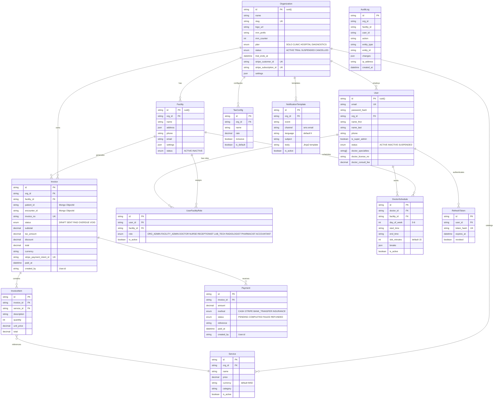

# Phase 5 — Entity Relationship Diagram

## MediCore HIS — ERD (Hybrid Database)

---

## PostgreSQL ERD



---

## MongoDB ERD

```mermaid
erDiagram
    Patient ||--o{ Encounter : "has visits"
    Patient ||--o{ Appointment : "books"
    Appointment ||--|| Encounter : "generates"

    Patient {
        ObjectId _id PK
        ObjectId org_id "tenant scope"
        string mrn UK "per org"
        object name "first last display"
        date dob
        string gender "male female other"
        string blood_type
        string phone
        string email
        string national_id
        object address
        object emergency_contact
        array allergies "substance type reaction severity"
        array problem_list "condition icd_code status"
        array documents "name type url uploaded_at"
        string status "active deceased transferred"
    }

    Appointment {
        ObjectId _id PK
        ObjectId org_id "tenant scope"
        ObjectId facility_id
        ObjectId patient_id FK
        string doctor_id "PG User.id"
        datetime start_time
        datetime end_time
        string type "consultation followup emergency"
        string status "booked confirmed checked_in in_progress completed cancelled no_show"
        string queue_token "T-042"
        string cancel_reason
        array status_history "status changed_at changed_by"
        string notes
    }

    Encounter {
        ObjectId _id PK
        ObjectId org_id "tenant scope"
        ObjectId facility_id
        ObjectId patient_id FK
        string doctor_id "PG User.id"
        ObjectId appointment_id FK UK
        date visit_date
        string status "draft in_progress signed_off archived"
        object vitals "bp hr temp weight height bmi spo2"
        object soap "subjective objective assessment plan"
        array diagnoses "icd_code description type"
        array prescriptions "drug_name form strength dosage frequency duration"
        array lab_orders "test_name ordered_at result_status"
        object ai_context "summary_shown differentials_shown feedback"
        string invoice_id "PG Invoice.id"
        datetime signed_off_at
        string signed_off_by "PG User.id"
    }
```

---

## Cross-Database References

| Source (DB) | Field | Target (DB) | Field | Type |
|-------------|-------|-------------|-------|------|
| Invoice (PG) | `patient_id` | Patient (Mongo) | `_id` | String reference (no foreign key) |
| Invoice (PG) | `encounter_id` | Encounter (Mongo) | `_id` | String reference |
| Encounter (Mongo) | `doctor_id` | User (PG) | `id` | String reference |
| Encounter (Mongo) | `invoice_id` | Invoice (PG) | `id` | String reference (set after billing event) |
| Appointment (Mongo) | `doctor_id` | User (PG) | `id` | String reference |
| Patient (Mongo) | `org_id` | Organization (PG) | `id` | ObjectId (cast from cuid) |

> **Note**: Cross-database references are **string-based, not enforced by a foreign key**. Application logic in the repository layer is responsible for ensuring referential integrity. The outbox pattern (see `02-database-strategy.md`) handles the critical Encounter → Invoice cross-DB write.
