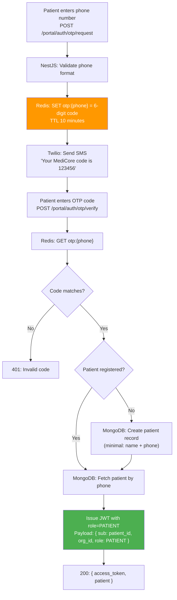
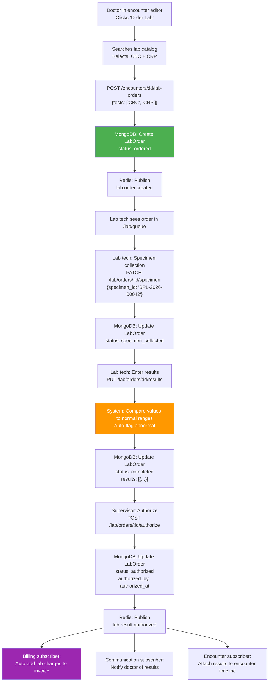
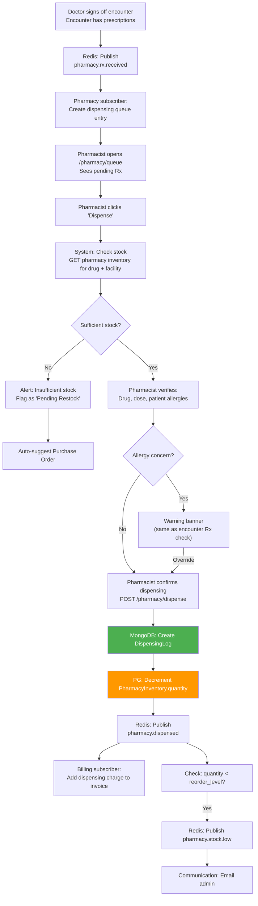
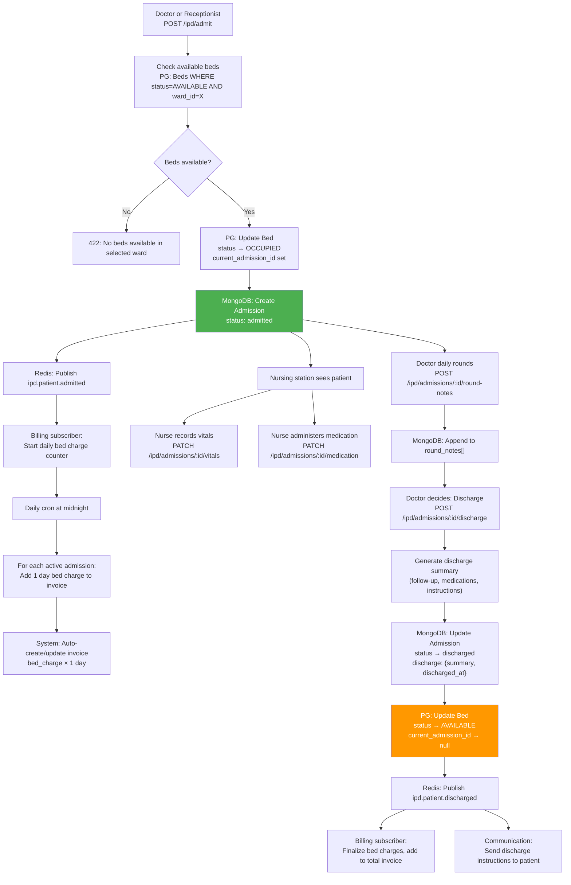
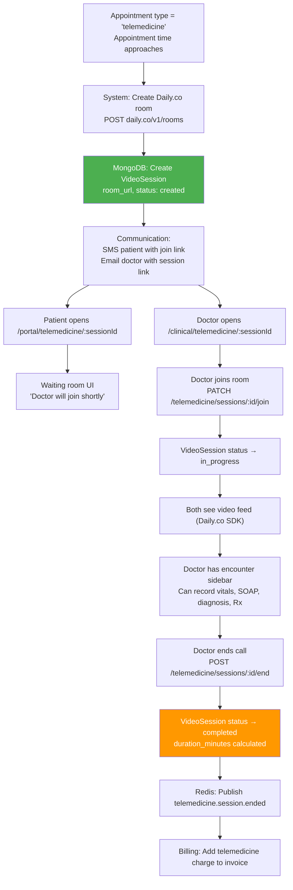
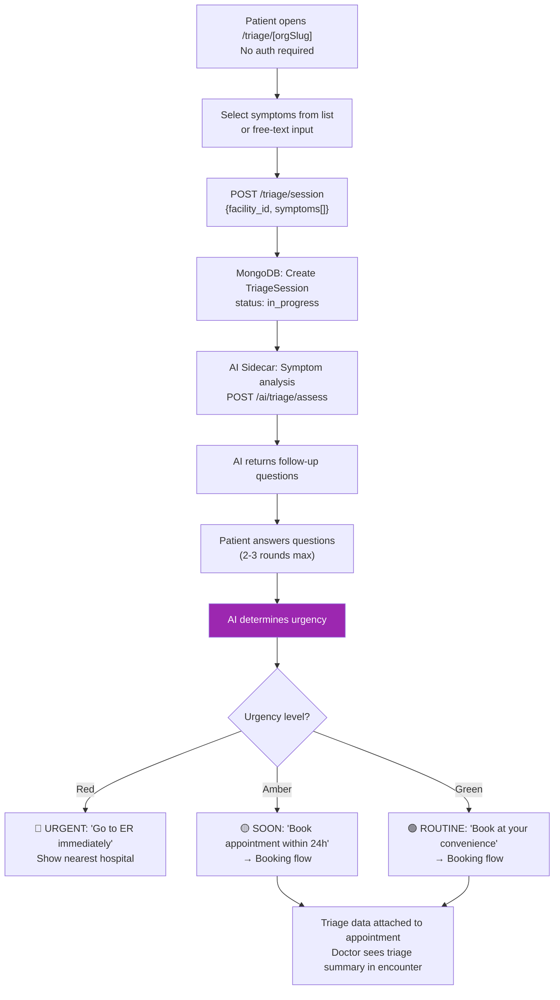
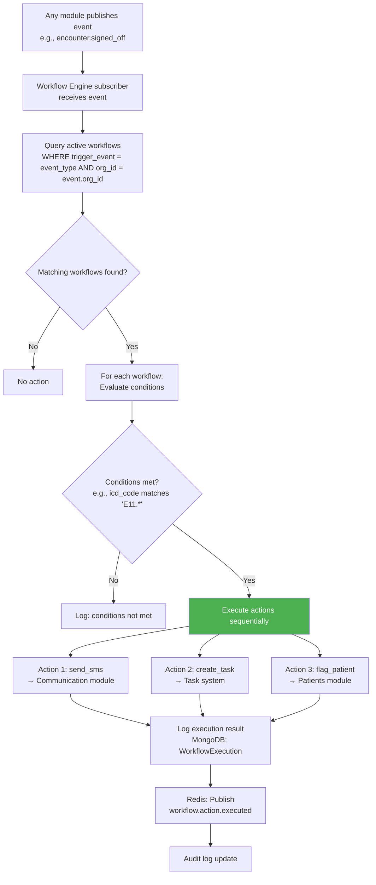
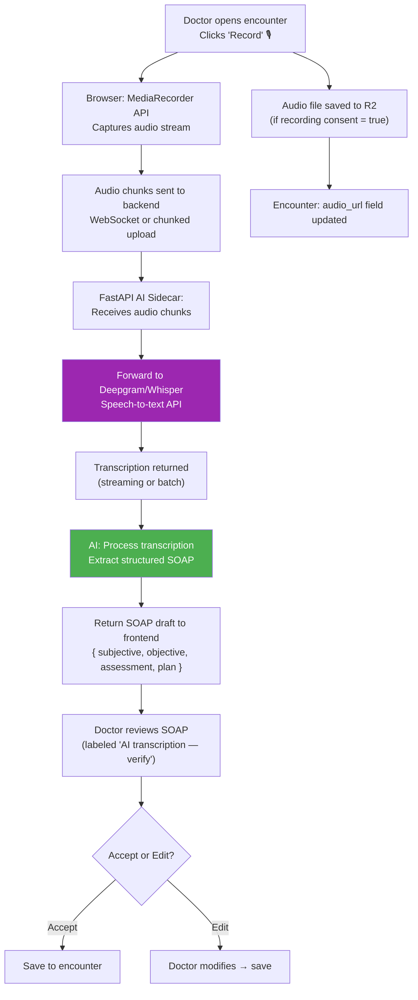
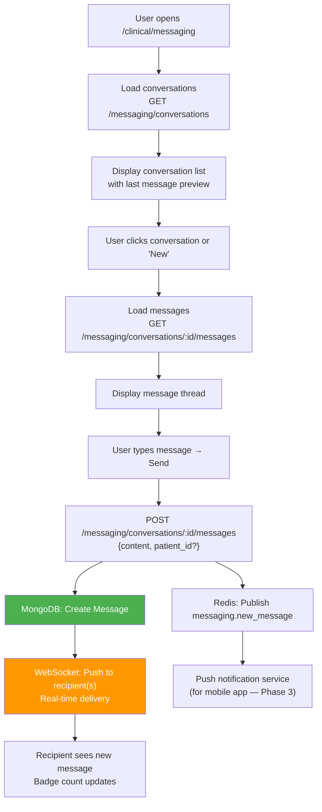

# Phase 2 & 3 — Data Flow Diagrams

## MediCore HIS — Key Data Flows for Extended Modules

---

## 1. Patient Portal — OTP Login Flow

---

## 2. Lab Order → Result → Billing Flow

---

## 3. Pharmacy — Prescription to Dispensing Flow

---

## 4. IPD — Admission to Discharge Flow

---

## 5. Telemedicine — Video Consultation Flow

---

## 6. Triage Chatbot Flow

---

## 7. Workflow Automation Flow (Phase 3)

---

## 8. Ambient Audio AI Flow (Phase 2)

---

## 9. Internal Messaging Flow (Phase 2)

