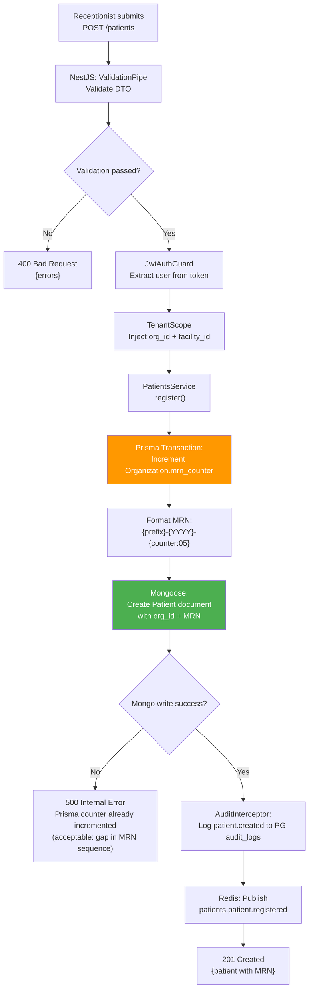
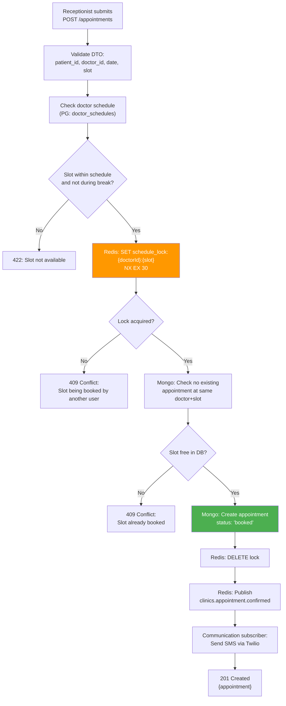
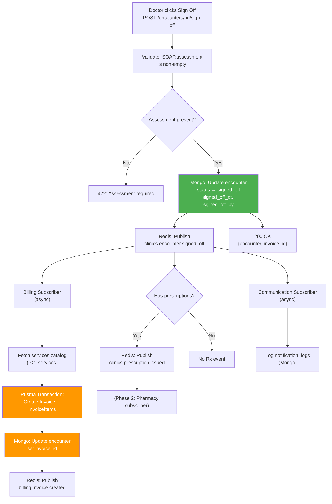
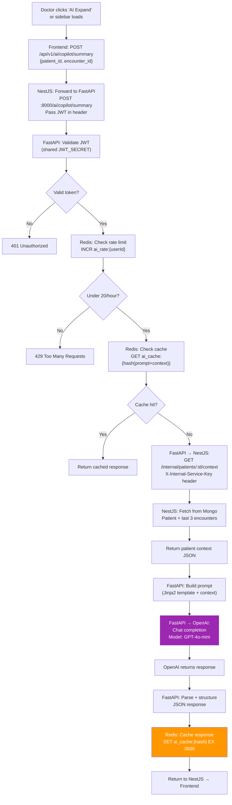
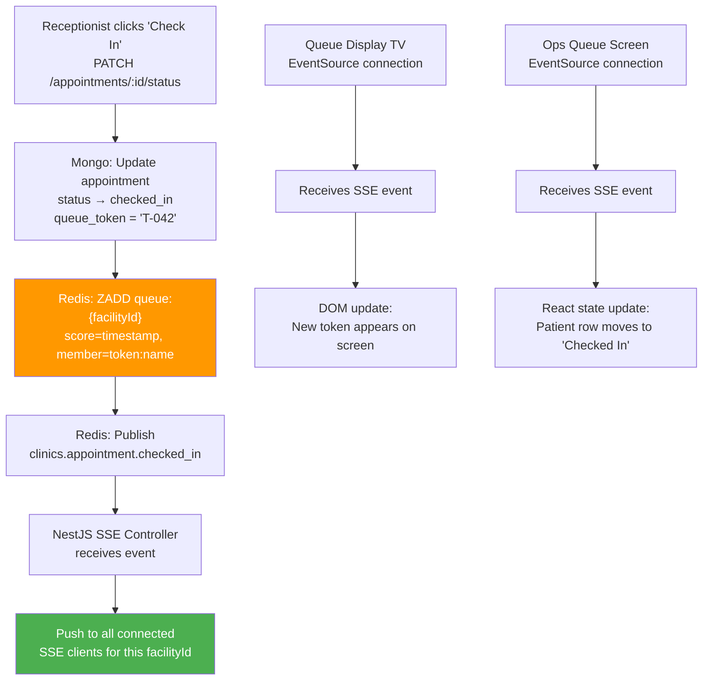
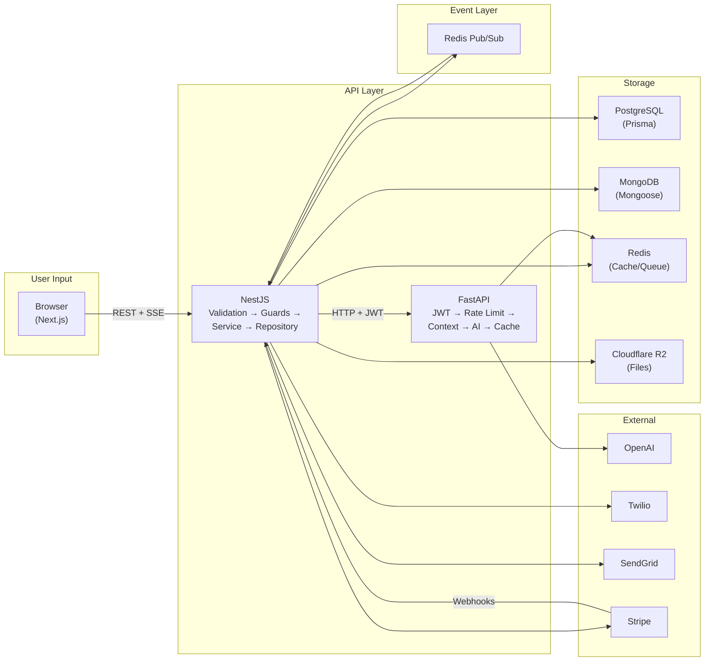

# Phase 5 — Data Flow

## MediCore HIS — End-to-End Data Flow Diagrams

---

## 1. Patient Registration Flow

**Cross-DB note**: MRN counter is in PostgreSQL (atomic increment), patient document is in MongoDB. If Mongo write fails after PG counter increments, we accept a gap in MRN sequence (next registration gets counter+1). This is acceptable — MRN gaps are common in medical systems.

---

## 2. Appointment Booking Flow

**Double-booking prevention**: The Redis lock (30-second TTL, NX flag) ensures that even under concurrent requests, only one booking for a given doctor+slot can proceed at a time. The lock is deleted immediately after the Mongo write succeeds. If the process crashes mid-booking, the lock auto-expires after 30 seconds.

---

## 3. Encounter Sign-Off Flow (Most Complex)

**Cross-DB consistency**: The sign-off creates data in both MongoDB (encounter status) and PostgreSQL (invoice). The outbox pattern ensures:
1. Encounter updated in Mongo (source of truth for clinical data)
2. Event published to Redis
3. Billing subscriber creates invoice in PG
4. Billing subscriber updates encounter in Mongo with `invoice_id` back-reference
5. If step 4 fails: retry up to 3× via Redis retry queue
6. If all retries fail: alert logged, manual review flag set

---

## 4. AI Copilot Request Flow

**Key design rules**:
- FastAPI NEVER touches databases directly — all context comes from NestJS internal API
- Rate limiting happens BEFORE the expensive OpenAI call
- Cache key is a hash of (prompt template version + patient_id + encounter context hash) — ensures clinically relevant changes bust the cache
- OpenAI model fallback: if GPT-4o-mini fails, retry once with GPT-4o. If both fail, return graceful error to frontend

---

## 5. SSE Queue Update Flow

**SSE architecture**: NestJS uses `@Sse()` decorator with Redis subscriber. Each connected client specifies their `facilityId`. The SSE controller filters events and only pushes to clients watching the relevant facility. The public queue display (`/queue-display/:facilityId`) uses the same SSE stream but requires no authentication.

---

## 6. End-to-End Data Flow Summary

