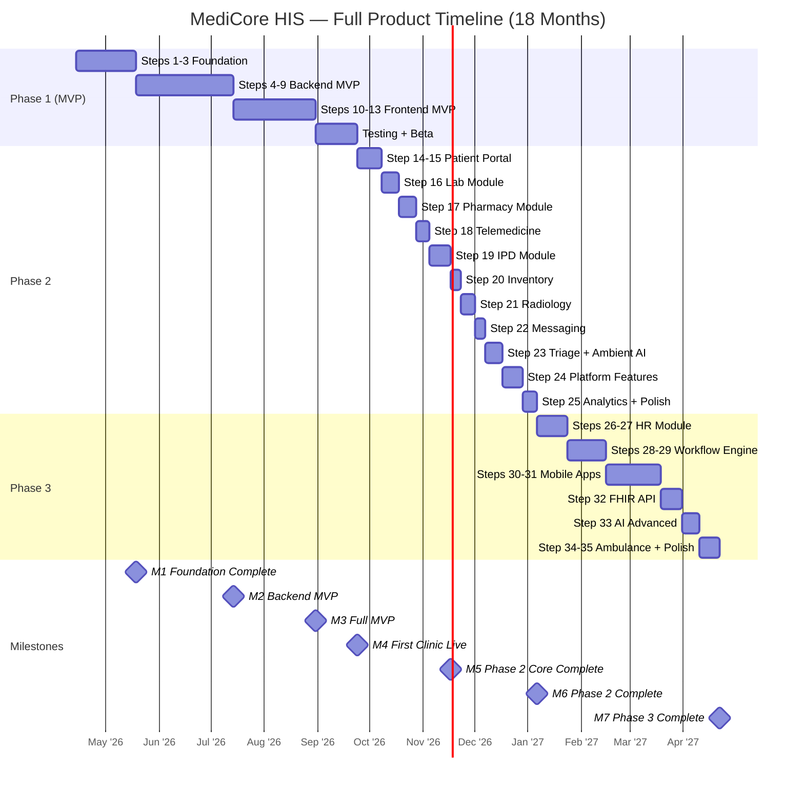
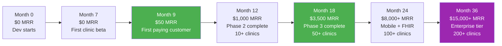

# Phase 2 & 3 — Milestones & Timeline

## MediCore HIS — Full Product Milestones (M5–M10)

> Extends `07-milestones.md` (M1–M4). MVP milestones remain unchanged.

---

## Gantt — Full Product Timeline

---

## M5 — Phase 2 Core Complete (Target: Month 10)

| Deliverable | Verification |
|-------------|-------------|
| Patient portal live (OTP auth, records, booking, payments) | Patient completes full self-service flow |
| Lab module working (order → specimen → result → authorize → billing) | Full lab cycle in <5 minutes |
| Pharmacy module working (Rx → dispense → stock → billing) | Allergy check fires correctly |
| IPD module working (admit → rounds → discharge → billing) | Full inpatient stay simulated |
| Telemedicine working (video + encounter + billing) | Video call on Chrome + mobile browser |
| 5+ clinics on platform | Multi-tenant with portal access |

**Sign-off**: Full simulation: OPD visit with lab order → results → pharmacy dispensing → billing → patient pays via portal.

---

## M6 — Phase 2 Complete (Target: Month 12)

| Deliverable | Verification |
|-------------|-------------|
| All Phase 2 modules live | Steps 14–25 passing acceptance |
| Radiology, messaging, triage, CMS, i18n, campaigns all working | Feature-level done checklist for each |
| ≥200 concurrent users supported | Load test with k6 passing |
| Arabic RTL rendering correct | Manual review of all screens |
| At least 1 campaign sent successfully | SMS campaign delivered |
| At least 2 workflows executing | Automation log shows executions |
| MRR ≥ $1,000 | Stripe dashboard |

**Sign-off**: Full product demo covering all modules, recorded as video.

---

## M7 — Phase 3 Complete (Target: Month 18)

| Deliverable | Verification |
|-------------|-------------|
| HR module working (staff, attendance, leave, payroll) | Payroll generated + payslip PDF |
| Workflow engine (rules + visual builder) | 5 workflows running in production |
| Patient mobile app in App Store + Play Store | Downloads possible |
| Doctor mobile app in App Store + Play Store | Doctor completes encounter from phone |
| FHIR R4 API validated | HAPI FHIR validator passes |
| AI advanced (optimization, risk scoring) | Schedule suggestions generated |
| MRR ≥ $3,500 | Stripe dashboard |

**Sign-off**: Oussama uses doctor mobile app to complete an encounter with AI copilot, patient pays via mobile app.

---

## Financial Milestones (Updated for Full Product)

---

## Infrastructure Cost Scaling

| Phase | Monthly Cost | Revenue Target | Margin |
|-------|-------------|---------------|--------|
| Phase 1 (MVP) | $102–117 | $50+ MRR | Break-even |
| Phase 2 (10 clinics) | $150–200 | $1,000 MRR | ~80% |
| Phase 3 (50 clinics) | $300–500 | $3,500 MRR | ~85% |
| Scale (200 clinics) | $1,000–1,500 | $15,000+ MRR | ~90% |

---

## Key Scaling Decision Points

| Decision Point | When | Options |
|---------------|------|---------|
| Hire first developer? | MRR > $1,000 OR Phase 2 taking >6 months | Part-time frontend dev ($500–800/mo) |
| Upgrade Railway → Dedicated? | >100 concurrent users consistently | Railway Pro ($50/service) |
| Upgrade Atlas → M30? | >5GB clinical data | M30 ($570/mo) |
| Enterprise customer asks for dedicated instance? | First enterprise inquiry | Separate Railway project ($200/mo extra) |
| Consider seed funding? | Product-market fit proven (20+ paying clinics) | $100K–250K to accelerate hiring + marketing |
