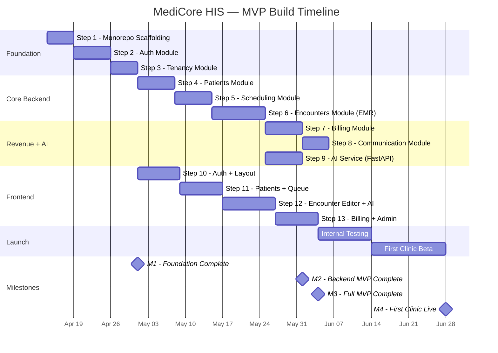

# Phase 7 — Milestones

## MediCore HIS — Build Phases with Deliverables

---

## Milestone Overview

> **Note**: Timeline assumes ~15–20 hours/week. Backend and frontend steps have limited parallelism (solo developer). Steps 9 and 10 can run in parallel since they're independent.

---

## Detailed Milestones

### M1 — Foundation Complete (Target: Month 1)

| Deliverable | Verification |
|-------------|-------------|
| Monorepo running locally | `pnpm dev` starts all 3 apps |
| Docker Compose: PG + Mongo + Redis | `docker compose up -d` → health checks pass |
| Auth flow working end-to-end | Login → JWT → protected endpoint works |
| Multi-tenancy enforced | 2 orgs created, zero cross-contamination proven |
| Onboarding wizard works | `POST /orgs/onboard` creates org+facility+user atomically |

**Sign-off**: Oussama verifies all acceptance criteria from Steps 1–3.

---

### M2 — Backend MVP Complete (Target: Month 3)

| Deliverable | Verification |
|-------------|-------------|
| Patient CRUD + search | Register, search, allergy add all work |
| Scheduling + queue | Booking, check-in, SSE queue, no-show cron |
| Encounters (full EMR flow) | Vitals → SOAP → diagnosis → Rx → sign-off → event |
| Billing auto-creation | Sign-off event → invoice created within 5 seconds |
| SMS + email notifications | Appointment SMS, invoice email with PDF |
| AI copilot (3 endpoints) | Summary, differentials, investigations all return valid results |
| All backend APIs pass acceptance tests | Postman/Insomnia collection with all endpoints green |

**Sign-off**: Full end-to-end test: book appointment → encounter → AI copilot → sign-off → invoice → payment → SMS notification.

---

### M3 — Full MVP Complete (Target: Month 5)

| Deliverable | Verification |
|-------------|-------------|
| All 25 screens implemented | Screen inventory checklist 100% complete |
| Onboarding wizard (frontend) | New user creates org in <10 minutes |
| Clinical encounter editor | 3-column layout with AI sidebar works |
| Billing UI | Invoice list, edit, payment recording, Stripe |
| Admin dashboard | Revenue charts, team management, audit log |
| Public queue display | Works on TV screen without login |
| Responsive design | All screens usable on iPad (1024px width) |

**Sign-off**: Oussama uses the system to create a full clinic simulation (10 patients, 10 encounters, AI used, billing recorded).

---

### M4 — First Clinic Live (Target: Month 7)

| Deliverable | Verification |
|-------------|-------------|
| Production deployment | Railway + Vercel + Atlas production instances |
| First real clinic onboarded | 1 clinic using MediCore daily for ≥2 weeks |
| Zero data leakage incidents | Security audit (manual checklist) passed |
| ≥60% encounters use AI copilot | Analytics query on AI usage |
| Billing matches manual records | Clinic owner confirms revenue numbers are accurate |
| System uptime ≥99.5% | Railway monitoring dashboard |

**Sign-off**: Clinic owner confirms the system is working satisfactorily for daily operations.

---

### M5 — First Revenue (Target: Month 8–9)

| Deliverable | Verification |
|-------------|-------------|
| Stripe billing for MediCore subscriptions | Clinic owner charged successfully |
| MRR ≥ $50/month | Stripe dashboard confirms |
| At least 1 paying customer | Signed subscription, not just beta |
| 3+ orgs on same instance | Multi-tenancy proven at scale |

**Sign-off**: Bank account shows recurring revenue from MediCore subscriptions.
